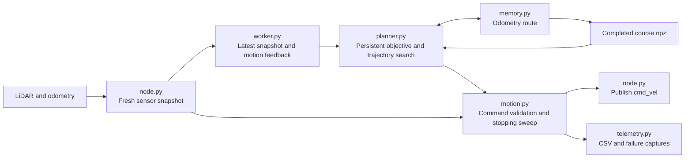

# Autonomous Mobile Robot Lab

Built for the TurtleBot 4 with ROS 2 Humble.

[Architecture](#lab-3-module-diagram) · [First run](amr_ws/README.md#lab-3-learn-and-replay) ·
[Second run](amr_ws/src/py_amr_ttb/py_amr_ttb/lab3/README.md#build-and-run) · [Tests](amr_ws/src/py_amr_ttb/py_amr_ttb/lab3/README.md#diagnostics-and-tests) ·
[Detailed Lab 3 guide](amr_ws/src/py_amr_ttb/py_amr_ttb/lab3/README.md)

## Lab 3 maze escape

Lab 3 navigates an obstacle course with live LiDAR and odometry. Go-to-goal
keeps a persistent objective, searches a disposable scan-local route, and selects
forward/turning trajectories together. An independent supervisor checks current
sensing and the complete stopping sweep before execution.

### Lab 3 module diagram

Go-to-goal records a completed route. Replay starts at the same physical
position and heading and checks saved waypoint shortcuts against live LiDAR.

- [Build, launch, and replay](amr_ws/README.md#lab-3-learn-and-replay)
- [Decision loop, configuration, and diagnostics](amr_ws/src/py_amr_ttb/py_amr_ttb/lab3/README.md)

## Earlier labs

| Lab | Reference |
| --- | --- |
| Lab 2: goals and shape tracking | [Lab 2 guide](amr_ws/src/py_amr_ttb/py_amr_ttb/lab2/README.md) · [Handoff checklist](docs/LAB2_HANDOFF.md) |
| Lab 1: teleoperation, wandering, and PID | [Demo guide](amr_ws/src/py_amr_ttb/py_amr_ttb/demo/README.md) |

### Lab 2 work plan

Previous team assignments, checklists, and detailed Lab 1 examples are preserved
in the [historical reference](docs/LABS1_2_REFERENCE.md#lab-2-work-plan).
