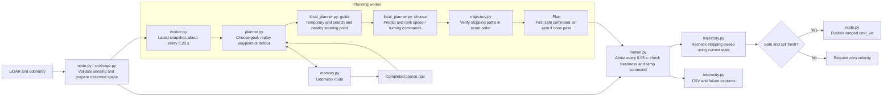

# Autonomous Mobile Robot Lab

Built for the TurtleBot 4 with ROS 2 Humble.

[Architecture](#lab-3-module-diagram) · [First run](amr_ws/README.md#lab-3-learn-and-replay) ·
[Second run](amr_ws/src/py_amr_ttb/py_amr_ttb/lab3/README.md#build-and-run) · [Tests](amr_ws/src/py_amr_ttb/py_amr_ttb/lab3/README.md#simulation-and-tests) ·
[Detailed Lab 3 guide](amr_ws/src/py_amr_ttb/py_amr_ttb/lab3/README.md)

## Lab 3 maze escape

Lab 3 navigates an obstacle course with live LiDAR and odometry. Go-to-goal
keeps a persistent objective, searches a disposable scan-local route, and selects
forward/turning trajectories together. An independent supervisor checks current
sensing and the complete stopping sweep before execution.

### Lab 3 module diagram

### How navigation decisions work

The robot separates three decisions: **where to go**, **how to move toward it**,
and **whether that movement can still be executed safely**.

| Component | Responsibility |
| --- | --- |
| `planner.py` | Owns the current objective, tracks progress, selects replay waypoints and chooses temporary detours after persistent lack of progress. Records the route and checks completion or timeout. |
| `local_planner.py` | Finds a nearby guide toward the objective, predicts combinations of linear and angular velocity, and selects the highest-ranked command whose stopping path passes validation. |
| `motion.py` | Checks plan and sensor freshness, ramps the selected command using acceleration limits, and validates execution against current sensing. Requests zero if checks fail; movement selection stays with the planner. |
| `trajectory.py` | Supplies motion prediction and stopping-path validation shared by planning and execution checks. |

An **objective** is the final goal, a saved replay waypoint or a temporary
detour. A **guide** is a nearby steering point toward that objective. A
**command** is `(v, w)`: linear speed in m/s and turning rate in rad/s.

1. **Read the environment.** Odometry supplies position, heading and measured
   velocity. LiDAR supplies obstacle returns and observed-space evidence. Recent
   scans are aligned with the robot's movement; old evidence expires.
2. **Choose the objective.** Learning normally aims for `(10, 0)` metres in the
   starting frame. Replay selects a saved waypoint. About five seconds without
   sufficient progress triggers selection of an observed detour, penalizing
   recently unsuccessful directions.
3. **Find a nearby guide.** A temporary grid uses 5 cm spacing and expanded
   obstacles to account for robot clearance. An eight-neighbour A*-style search
   finds a path toward the objective without diagonal corner cutting. The guide
   advances along that path up to 0.78 m from the robot while checking the direct
   line to each point. It therefore points toward an opening rather than through
   the wall beside it. Unknown cells can participate in this search; only later
   stopping-path checks authorize actual movement through observed space.
4. **Select a movement.** Candidate commands include straight driving, curved
   driving, turning in place and limited reversing. Predictions include measured
   motion, delay, acceleration and braking to rest. Scores reward progress,
   heading alignment and forward speed while penalizing steering changes and
   reversing. Candidates are validated in score order; none passing means zero.
5. **Supervise execution.** Between planning updates, the faster control loop
   checks the selected command again using current sensing and the ramped
   velocity. New obstacles or stale inputs can cause a zero request even when
   the earlier planning check passed. A zero request still requires physical
   braking; it is not an instantaneous stop.

For example, when a wall blocks the final goal, the overall planner can keep
that goal while the local planner guides the robot around the wall's end. If a
new scan blocks the selected curve, the motion controller requests zero and a
later planning update can choose another command. A temporary detour is selected
only after persistent lack of progress, not on every rejected command.

Planning and control intervals are scheduling targets. The local grid is
discarded each update, so default learning uses no persistent occupancy map.
These local decisions do not guarantee escape from every maze.

### Learning and replay

Go-to-goal records a completed route. Replay starts at the same physical
position and heading and checks saved waypoint shortcuts against live LiDAR.
It uses the same local planner and execution checks, so it adapts commands to
current sensing instead of playing back previously recorded velocities.
Completed learning saves `~/amr_lab3_runs/course.npz`; replay writes
`course.replay.npz` while preserving the learned route.

- [Build, launch, and replay](amr_ws/README.md#lab-3-learn-and-replay)
- [Decision loop, configuration, and diagnostics](amr_ws/src/py_amr_ttb/py_amr_ttb/lab3/README.md)

## Earlier labs

| Lab | Reference |
| --- | --- |
| Lab 2: goals and shape tracking | [Lab 2 guide](amr_ws/src/py_amr_ttb/py_amr_ttb/lab2/README.md) · [Handoff checklist](docs/LAB2_HANDOFF.md) |
| Lab 1: teleoperation, wandering, and PID | [Demo guide](amr_ws/src/py_amr_ttb/py_amr_ttb/demo/README.md) |

### Lab 2 work plan

Previous team assignments, checklists, and detailed Lab 1 examples are preserved
in the [historical reference](docs/LABS1_2_REFERENCE.md#lab-2-work-plan).
