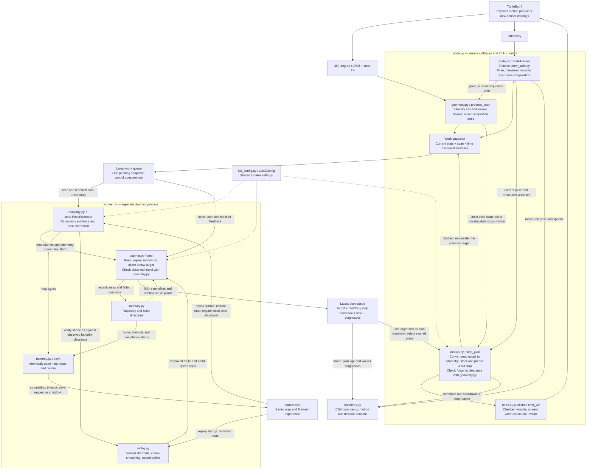

# Autonomous Mobile Robot Lab

Built for the TurtleBot 4 with ROS 2 Humble.

[Architecture](#lab-3-module-diagram) · [First run](#build-and-first-run) ·
[Second run](#second-run) · [Tests](#offline-checks-and-current-status) ·
[Detailed Lab 3 guide](amr_ws/src/py_amr_ttb/py_amr_ttb/lab3/README.md)

## Lab 3 maze escape

The robot starts without a map. It uses 360-degree LiDAR and odometry to choose
reachable targets, favor useful forward travel, reduce turning, and recover from
dead ends. The first run saves map evidence and its trajectory. The second run
aligns near the original start and follows a shortened route through verified
free space, while continuing to check live LiDAR.

The current goal assumption is **10 metres ahead of the initial pose**, at
`(10, 0)` in the starting frame. Completion uses that coordinate; open space
alone does not identify the finish. The default cruise limit is **0.30 m/s**.
Scoring, timing, clearance, and motion response are configurable.

### Lab 3 module diagram



The two loops share sensor snapshots but have different jobs:

- **Planning chooses where to go.** The worker updates the map, queries clearance
  and failure history, and returns a target paired with its map transform.
- **Control checks how to move now.** It uses the latest state and scan to test
  steering and the complete stopping path. A blocked result goes back to planning;
  a saved route or held target cannot override the live clearance checks.
- **Replay reuses evidence.** At startup, the saved map supports route verification
  and initial alignment. The improved route guides the same planner and controller.

The control loop checks live scan clearance every **0.05 s**. The worker updates
the map every **0.20 s** and normally chooses a direction every **0.50 s**.
A blocked or nearby target can trigger an earlier decision. Only the latest
pending sensor snapshot is retained, so planning work does not accumulate.

### How the two runs work

| Stage | What the robot does | What it produces |
| --- | --- | --- |
| Observe | Combine 360-degree LiDAR with scan-time odometry; distinguish free, occupied, and unknown space | Usable travel distances, local pose, and map evidence |
| Choose | Score headings across four front and four rear sections; favor goal progress and travel while penalizing turns and failed directions | A reachable point held between decisions |
| Drive | Steer continuously using measured linear/angular velocity; check the predicted path through a complete stop | A velocity command that accounts for motion response |
| Recover | Follow nearby walls when appropriate, or backtrack from a stall or confirmed capped pocket | A new approach and a penalty for the failed direction |
| Learn | Record the route, map, and directional experience during the first run | A saved course for replay |
| Replay | Align near the original start, trim detours through observed free space, and follow the improved route | A second run that still reacts to current LiDAR |

Unknown continuation remains a possible way forward. A region is rejected as
closed only when the observed geometry supports that conclusion; unknown space
does not count as verified clearance for driving or route shortcuts.

### Build and first run

From the repository root on the ROS machine:

```bash
cd amr_ws
source /opt/ros/humble/setup.bash
rosdep install --from-paths src --ignore-src -r -y
colcon build --symlink-install --packages-select py_amr_ttb
source install/setup.bash
ros2 launch py_amr_ttb lab3_go_to_goal.launch.py robot_namespace:=/TTB10
```

The launch begins moving after valid sensors and a plan arrive. It uses
`/TTB10/scan`, `/TTB10/odom`, and `/TTB10/cmd_vel`; run one velocity controller
at a time. The robot's odometry child frame must match the `base_frame` launch
argument, which defaults to `base_link`.

### Second run

After completing the first run, stop that process and place the robot near its
original position and heading. In a terminal with the ROS workspace sourced:

```bash
ros2 launch py_amr_ttb lab3_replay.launch.py robot_namespace:=/TTB10
```

The default learned course is `~/amr_lab3_runs/course.npz`. Both launches accept
`run_file:=/absolute/path/course.npz`. Replay requires a completed first run and
a successful initial scan alignment. Its output is saved separately as
`course.replay.npz`.

To stop and queue a save from another sourced terminal:

```bash
ros2 service call /lab3_controller/stop std_srvs/srv/Trigger '{}'
```

### Code and configuration

The new implementation lives in
[`lab3/`](amr_ws/src/py_amr_ttb/py_amr_ttb/lab3/). It reuses
[`odom_utils.py`](amr_ws/src/py_amr_ttb/py_amr_ttb/odom_utils.py) and the shared
[`lab_config.py`](amr_ws/src/py_amr_ttb/py_amr_ttb/lab_config.py).
`Lab3Config` contains the tunable defaults; every field is also a ROS startup
parameter. Restart the controller to apply changes.

| Setting group | Where to start |
| --- | --- |
| Goal and speed | `goal_x`, `goal_y`, `max_linear`, `max_angular` |
| Direction scoring | `weight_goal`, `weight_travel`, `weight_heading`, `weight_rotation`, `weight_history` |
| Lookahead and commitment | `scoring_horizon`, `target_distance`, `decision_period`, `switch_margin` |
| Clearance and motion response | `robot_radius`, `safety_margin`, acceleration/braking limits, `command_latency` |
| Recovery and replay | `stall_timeout`, `backtrack_distance`, `route_margin`, `replay_start_search` |

The [detailed Lab 3 guide](amr_ws/src/py_amr_ttb/py_amr_ttb/lab3/README.md)
explains each module, the parameter defaults, pose filtering, and save/reset/logging
instructions. The [workspace quick start](amr_ws/README.md) gives commands from
inside `amr_ws`.

### Offline checks and current status

From the repository root, with Python 3.10+ and NumPy:

```bash
python3 -m unittest discover -s amr_ws/src/py_amr_ttb/test -p test_lab3.py -v
PYTHONPATH=amr_ws/src/py_amr_ttb python3 -m py_amr_ttb.lab3.simulate \
  --scenario pocket --two-runs --output output/lab3-pocket
```

The simulator supports `straight`, `obstacle`, `pocket`, and `corner`. It uses
the navigation implementation with a separate robot response model and reports
completion, clearance, speed, and elapsed simulated time.

All 28 Lab 3 tests passed in local validation, including recovery, pose filtering,
sensor/plan expiry, worker execution, and two-run reuse. **ROS integration and
physical TurtleBot validation remain pending.** Acceleration, braking, and noise
settings need robot measurements; simulation results do not establish hardware
performance. See the detailed guide for localization and scan-timing limits.

## Earlier labs

| Lab | Reference |
| --- | --- |
| Lab 2: goals and shape tracking | [Lab 2 guide](amr_ws/src/py_amr_ttb/py_amr_ttb/lab2/README.md) · [Handoff checklist](docs/LAB2_HANDOFF.md) |
| Lab 1: teleoperation, wandering, and PID | [Demo guide](amr_ws/src/py_amr_ttb/py_amr_ttb/demo/README.md) |

### Lab 2 work plan

Previous team assignments, checklists, and detailed Lab 1 examples are preserved
in the [historical reference](docs/LABS1_2_REFERENCE.md#lab-2-work-plan).
