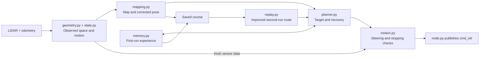

# ECE 4060 AMR workspace

This directory is the ROS workspace. The Python package is in
`src/py_amr_ttb`, and its launch files are in `src/py_amr_ttb/launch`.
Commands below assume this directory is your working directory.

## Lab 3: learn and replay

Lab 3 uses LiDAR and odometry to explore an unknown obstacle course, save its map
and trajectory, and improve the next run. The current finish assumption is
`(10, 0)` metres in the initial robot frame, with a default cruise limit of
0.30 m/s. See the
[Lab 3 module diagram, behavior, and tuning guide](src/py_amr_ttb/py_amr_ttb/lab3/README.md).



`node.py` runs the control timer; `worker.py` owns mapping and planning in a
separate process. Both use `Lab3Config`, and pose handling reuses `odom_utils.py`.
See the [full module diagram](../README.md#lab-3-module-diagram) for process
boundaries, timing, and the connections to configuration and logging.

Build and start the first run:

```bash
source /opt/ros/humble/setup.bash
rosdep install --from-paths src --ignore-src -r -y
colcon build --symlink-install --packages-select py_amr_ttb
source install/setup.bash
ros2 launch py_amr_ttb lab3_go_to_goal.launch.py robot_namespace:=/TTB10
```

This starts moving once valid sensors and a plan arrive. Run one velocity
controller at a time. Both Lab 3 launches accept `robot_namespace`, `base_frame`
(default `base_link`), and `run_file` (default `~/amr_lab3_runs/course.npz`).

After a completed first run, stop its process, return the robot near the original
position and heading, and start replay from a sourced terminal:

```bash
ros2 launch py_amr_ttb lab3_replay.launch.py robot_namespace:=/TTB10
```

Replay waits for a confident scan alignment, uses the saved course, and checks
the current scan before commanding motion. It saves results to
`course.replay.npz`, preserving `course.npz`.

Stop and queue a save from another sourced terminal:

```bash
ros2 service call /lab3_controller/stop std_srvs/srv/Trigger '{}'
```

Settings live in `Lab3Config` in
[`lab_config.py`](src/py_amr_ttb/py_amr_ttb/lab_config.py). They can be overridden
with ROS startup parameters when running `lab3_controller` directly; the detailed
guide has an example. Pose conversion reuses
[`odom_utils.py`](src/py_amr_ttb/py_amr_ttb/odom_utils.py).

Offline checks from this workspace directory, with Python 3.10+ and NumPy:

```bash
python3 -m unittest discover -s src/py_amr_ttb/test -p test_lab3.py -v
PYTHONPATH=src/py_amr_ttb python3 -m py_amr_ttb.lab3.simulate \
  --scenario pocket --two-runs --output ../output/lab3-pocket
```

All 28 Lab 3 tests passed locally. ROS transport, TF/QoS, physical braking,
LiDAR timing, and actual course performance still need robot validation.

## Earlier labs

- [Lab 2 goals and shape tracking](src/py_amr_ttb/py_amr_ttb/lab2/README.md)
- [Lab 1 task demos](src/py_amr_ttb/py_amr_ttb/demo/README.md)
- [Historical work plans and controller notes](../docs/LABS1_2_REFERENCE.md)
