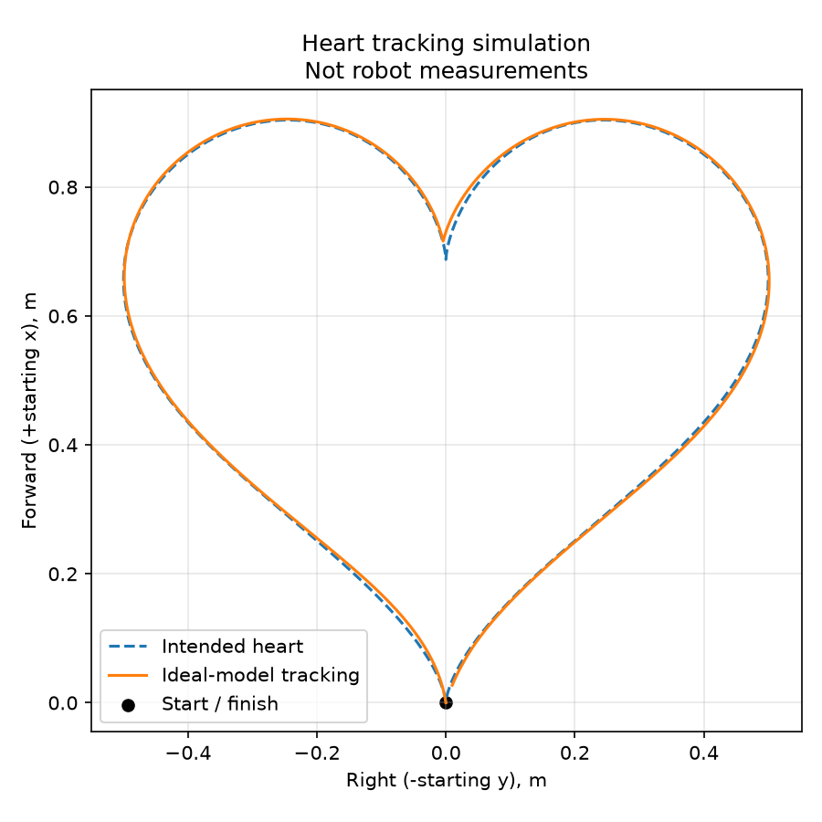

# Heart tracking

`navigation.py` contains `heart_points(width)` and `HeartPath`; `lab2_heart.py`
owns ROS connections, state transitions, stopping and diagnostics. The existing
star, square and circle controllers are unchanged by this addition.

## Behavior

The first valid odometry pose defines the fixed starting robot frame. Starting
at the bottom tip, the robot traces the left lobe, stops at the upper notch for
0.30 s, aligns to the right lobe, follows it back to the bottom tip and remains
stopped. Curves use simultaneous forward and turning velocity through the
existing `pursuit_command` helper. There is no lateral velocity command.

The heart is generated from the parametric curve documented in
[the design](../../../../../docs/HEART_PROPOSAL.md), with its symmetry axis
along initial +x and full lateral extent along y. Each lobe is resampled into
200 segments approximately uniform in arc length. A local projection window
advances monotonically along the active lobe. Lookahead is clamped at the
notch/final tip; proximity to the initial origin alone cannot finish the task.
Completion requires ordered progress and position within 0.03 m of the tip.

Controller states: `ALIGN -> FOLLOW -> CUSP_STOP -> ALIGN -> FOLLOW -> DONE`.
Every transition out of FOLLOW to a sharp-point stop publishes zero. ALIGN
turns in place toward an outgoing secant (the mathematical derivative is zero
at the cusp). Forward speed decreases approaching each sharp point; pursuit
also reduces speed when curvature would exceed the angular limit.

Missing/invalid/stale odometry commands zero and preserves route state; valid
data resumes the unfinished run. Freshness uses local receipt time (0.5 s).
Path error beyond 0.20 m latches `FAILED` and zero velocity until relaunch.
That limit refers to the local active route window, not a global nearest point.
Keep the robot still while capturing the origin. Do not reset odometry mid-run.
The node does not avoid obstacles or guarantee stopping after process/network
failure; physical stopping and the robot's command timeout require robot tests.

## Build and run on Ubuntu

From the updated ROS workspace containing `src/py_amr_ttb`:

```bash
source /opt/ros/humble/setup.bash
colcon build --symlink-install --packages-select py_amr_ttb
source install/setup.bash
# Starts robot motion automatically once valid odometry arrives:
ros2 launch py_amr_ttb lab2_heart.launch.py
```

Run only one motion controller. Start with a controlled trial; the default
center path is about 1.0 m wide and 0.91 m forward, with extra clearance needed
for the robot body and tracking error. Ctrl+C stops the controller normally.

An alternative command with explicit startup parameters:

```bash
ros2 run py_amr_ttb lab2_heart --ros-args -p width:=1.0 -p speed:=0.08 -p lookahead:=0.12
```

These three parameters default to `HEART_WIDTH`, `HEART_SPEED` and
`HEART_LOOKAHEAD` in `lab_config.py`. Other settings there are
`HEART_POSITION_TOLERANCE`, `HEART_CUSP_STOP_TIME`, and `HEART_MAX_PATH_ERROR`.
Speed must be positive and <=0.20 m/s; lookahead must be positive and less
than 0.4*width; tolerance must be positive and less than width/10. Keep the
default slow speed until physical tracking and stopping are verified. Width,
speed and lookahead are read only at startup; restart to apply changes.

## Record and plot

From repository root, start the recorder while stationary in a sourced terminal:

```bash
python3 amr_ws/scripts/plot_lab2.py --record output/lab2/heart_run01.csv
```

After valid odometry is arriving, launch the heart in another sourced terminal.
Stop the recorder with Ctrl+C after the robot finishes. Plot using the same
width as the controller:

```bash
python3 amr_ws/scripts/plot_lab2.py --csv output/lab2/heart_run01.csv --route heart --heart-width 1.0 --output output/lab2/heart_run01.png
```

This saves a measured trajectory PNG and JSON summary, including the overlay's
heart width. A small final error alone does not prove successful traversal;
inspect both lobes, the notch and ordered-progress diagnostics. Preserve run
settings and use a new filename for each trial. No heart robot data has been
collected by the coding agent.

Useful diagnostics (in another sourced terminal):

```bash
ros2 run rqt_plot rqt_plot /TTB10/lab2_heart/progress/data /TTB10/lab2_heart/path_error/data /TTB10/lab2_heart/linear_command/data /TTB10/lab2_heart/angular_command/data
```

Other Float64 topics under `/TTB10/lab2_heart/`: x, y, yaw, target_x,
target_y, section, distance, done. `progress` is 0..1; `section` is 0 for the
left lobe and 1 for the right; `distance` is to the current sharp point.
After completion `done=1` and commands stay zero. Diagnostics publish only
when odometry is fresh; zero velocity still publishes every timer tick.

## Offline verification

All 44 regression tests pass locally. A separate default-width ideal-model
run completes in approximately 47.5 s with 0.0288 m final position error.
This is simulated odometry, not a robot measurement:



```bash
python3 -m unittest discover -s amr_ws/src/py_amr_ttb/test -p 'test_lab2_heart.py' -v
python3 -m unittest discover -s amr_ws/src/py_amr_ttb/test -p 'test_lab2_*.py' -v
```

Tests cover geometry, ordered progress/no early finish, widths 0.6/1.0/1.4 m,
rotated origins, a small disturbance, curved commands, notch dwell/alignment,
invalid/stale-data stopping and recovery, latched tracking failure, shutdown,
plotting and launch installation. They use ROS doubles and ideal kinematics;
they do not establish physical accuracy or validate Ubuntu ROS transport.
