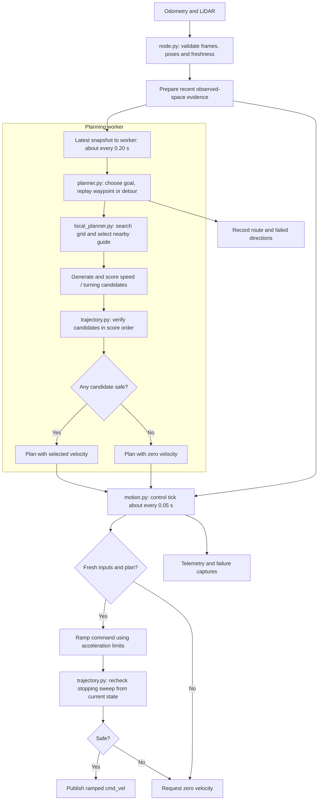

# Lab 3: navigate and replay a course

[Repository overview](../../../../../README.md) · [Workspace quick start](../../../../README.md)

Lab 3 drives toward a goal using odometry and LiDAR, records the travelled route,
and can replay a completed recording. The default goal is `(10, 0)` metres in
starting odometry. Learning uses a temporary scan-local lattice, not a persistent
occupancy map. Replay uses the same live trajectory planner and motion checks.

## Build and run

From the repository's `amr_ws` directory on the ROS machine:

```bash
source /opt/ros/humble/setup.bash
colcon build --symlink-install --packages-select py_amr_ttb
source install/setup.bash
ros2 launch py_amr_ttb lab3_go_to_goal.launch.py
```

The default namespace is `/TTB10`; `robot_namespace:=/TTB10` is optional.
Use `robot_namespace:=/OTHER_ROBOT` to select another robot. Both launches remap
TF topics to that namespace. The default topics are `/TTB10/odom`,
`/TTB10/scan`, and `/TTB10/cmd_vel`.

The controller starts driving when its inputs and plan are ready. Use one active
velocity controller. Odometry's twist child frame must match `base_frame`
(default `base_link`), and laser TF must describe a horizontal scan plane.
Upright and inverted horizontal laser mounting are supported.

After a completed learning run, stop the process and return the robot to the
same starting position and heading:

```bash
ros2 launch py_amr_ttb lab3_replay.launch.py
```

Both launches accept `run_file:=/absolute/path/course.npz`. The default is
`~/amr_lab3_runs/course.npz`. Learning saves completed runs there and unfinished
runs to `course.incomplete.npz`. Replay writes `course.replay.npz` without
replacing the learned recording. Replay requires a completed route.

```bash
ros2 service call /lab3_controller/stop std_srvs/srv/Trigger '{}'
ros2 service call /lab3_controller/save std_srvs/srv/Trigger '{}'
ros2 service call /lab3_controller/reset std_srvs/srv/Trigger '{}'
```

Stop latches the controller stopped and queues a save. Reset requires a stopped
run and stationary odometry, then establishes a new starting frame. Save runs
asynchronously. Shutdown requests zero velocity and asks the worker to save.

## Navigation loop



### Who decides what?

| Module | Question it answers | Output |
| --- | --- | --- |
| `planner.py`: `Planner.step()` | What should the robot move toward? | A goal, replay waypoint or detour, packaged with the local planner's command in a `Plan` |
| `local_planner.py`: `TrajectoryPlanner.choose()` | Which movement makes progress toward that objective and passes prediction checks? | One linear/angular velocity pair `(v, w)`, or zero if no candidate passes |
| `motion.py`: `MotionController.step_plan()` | Can the selected movement still be executed safely using current sensing? | A ramped velocity command, or a zero request |

The **objective** may be several metres away. The **guide** is a nearby point
used to steer toward that objective around local obstacles. The **command** is
a linear speed `v` in m/s and angular speed `w` in rad/s. A guide can change on
every planning update without changing the objective. A detour changes the
objective itself after persistent lack of progress.

Planning submissions normally occur every 0.20 s; control ticks target 0.05 s.
The worker handles the latest available snapshot asynchronously. Control can
reuse a plan while it remains fresh, but rechecks its execution each tick.
These periods are scheduling targets, not execution-time guarantees.

### 1. Validate sensing and freshness

Odometry establishes a fixed starting frame and supplies signed measured speeds.
Sensor timestamps pair each scan with its acquisition pose and TF. Freshness is
measured with **local monotonic receipt time**; a constant PC-to-robot clock offset
needs no SSH measurement or NTP synchronization. Robot-side timestamps must still
be usable for pose interpolation and TF. Receipt timing cannot detect delay that
occurred before a message arrived.

One background coverage job prepares up to six recent, pose-aligned scans.
Evidence expires with the sensor timeout. Obstacle returns override free-space
evidence. Invalid beams remain unknown except for bounded near-field gaps:
bracketing valid beams must be within 4 degrees, and inferred coverage is limited
by their shorter range, connecting chord and 0.50 m from the laser.

### 2. Maintain an objective

The planner owns one goal, replay waypoint or temporary detour. Replay advances
through route samples and checks shortcuts against current sensing within its
1 m waypoint lookahead.

A reduction of more than 5 cm in objective distance records progress. After
`stall_timeout + 2` seconds without progress (5 seconds by default), the planner
records a failed direction and ranks observed detours by available travel,
distance to the goal and recent failure penalties. A detour clears when reached
within 0.20 m. Learning then returns to the goal; replay resumes route selection.
Reaching the goal tolerance completes the run; `max_runtime` ends an unfinished run.

### 3. Select a scan-local guide

`TrajectoryPlanner.guide()` converts the objective into a nearby steering
point in five steps:

1. **Build a temporary grid.** The lattice spans about 4.8 m, with cells 5 cm
   apart, centred on the robot's position rounded to the grid. Obstacle returns
   and grid cells are expressed in the same odometry frame. The lattice is
   rebuilt each update; default learning does not retain it as a global map.
2. **Expand obstacles.** Cells within the clearance radius plus 0.15 grid cells
   of an obstacle return are blocked. Planning for the robot's centre then
   accounts approximately for its body clearance. With the defaults, this
   inflation radius is 0.1975 m. The start cell is explicitly made available to
   seed the search; this does not waive the later motion-clearance checks.
3. **Search toward the objective.** An A*-style search ranks cells by path
   length so far plus straight-line distance to the objective. It permits eight
   neighbours, charges diagonal moves their longer distance, and forbids
   diagonal moves between blocked corners. Its destination is the unblocked
   grid cell closest to the objective, including when the objective is outside
   the grid. If that destination is unreachable, it retains the reachable cell
   closest to the objective and reconstructs a path to it.
4. **Walk the path to choose a guide.** Starting with the first path step, the
   planner advances through points within `local_lookahead` (0.78 m measured
   directly from the robot). Each line from the robot to a candidate point is
   sampled about every 2.5 cm and checked against obstacle returns with clearance
   radius plus 0.005 m. It stops advancing at the first out-of-range or blocked
   point. This prevents aiming straight through a corner merely because the
   grid path bends around it. The first path step is the fallback; if the search
   produces fewer than two points, the objective is returned as the fallback.
5. **Use the objective directly when appropriate.** If it is within lookahead,
   the search reaches a cell within one grid spacing of it, and its direct line
   passes the obstacle check, the objective itself becomes the guide.

The grid initially treats cells without nearby obstacle returns as available,
including unknown space. Its `free` array therefore means available for this
search, not confirmed empty by LiDAR. The guide influences candidate ranking;
it never authorizes motion. Observed space and the full stopping sweep must
still pass the trajectory validator, including for fallback guides.

### 4. Rank executable velocities

Candidates combine forward speeds in 0.05 m/s increments, zero, the current
forward cap and an allowed reverse speed. Steering candidates include 0.35 rad/s
increments, the angular limits, heading correction and previous selected steering.
The planner limits `abs(v * w)` by the lateral-acceleration setting and reduces
the forward cap near the objective using braking distance.

For example, `(v, w) = (0.25, 0.70)` requests forward motion while turning
left. A zero linear speed with nonzero angular speed requests rotation in place;
negative linear speed requests reversing. The planner evaluates combinations,
so steering and forward motion can occur together.

Each candidate starts at measured velocity, includes command latency plus scan
receipt age, accelerates toward the command, then brakes to rest. Its score is:

```text
progress toward guide
+ alignment_weight * heading improvement
+ speed_weight * signed linear speed
- steering_weight * change in angular command
- 0.12 when reversing
```

Heading improvement uses the same initial guide bearing for every candidate.

A high score alone cannot select a command. Candidates are checked in descending
score order: an inexpensive obstacle-contact filter first rejects obvious
collisions, then the shared validator checks clearance and observed space along
the stopping sweep. The first candidate that passes is returned. If none passes,
the result is `(0, 0)` with `NO_SAFE_TRAJECTORY`.

### 5. Supervise execution

The control callback checks sensor and plan age, ramps the previous published
command toward the selected command, and validates its stopping sweep against
current sensing and measured velocity. It does not select another route.
Rejected commands request zero velocity. A zero request is not an instantaneous
physical stop; the prediction includes braking motion.

The local planner checks a requested command using its planning snapshot. The
supervisor checks the ramped command using the current state, which may differ
because the robot has moved or a newer scan has arrived. Both use the shared
`trajectory.py` validation logic. The supervisor does not try the planner's
second-best candidate if execution fails; it requests zero and leaves movement
selection to a later planning update.

For example, a wall blocks the final goal. `planner.py` keeps the goal as the
objective; `local_planner.py` finds a guide near the wall's opening and selects a
forward-left curve. `motion.py` ramps toward that command and verifies its
stopping sweep. If a new scan reveals an obstacle in the curve, the supervisor
requests zero. The next planning update can choose another movement. Only
persistent lack of objective progress causes `planner.py` to select a detour.

Worker queues hold only the latest pending work and result. A plan's age starts
at its input snapshot, not when computation finishes. The node also checks
control duration and evidence expiry before publishing. Python callbacks cannot
preempt already-running computation or retract the preceding command during it.

## Stopping clearance

Validation covers each predicted path segment with a midpoint disk whose radius
is the configured clearance radius plus half the segment length. Both obstacle
clearance and observed space must pass through the full stopping path. Turning
commands also pass a second prediction with reduced angular acceleration and
braking. Linear response is unchanged in that second prediction.

The same clearance policy applies at every speed. There is no separate escape
exception for a robot already inside the clearance margin. If no candidate
passes, the planner requests zero and reevaluates.

Measured reverse travel is limited to 0.70 m, reset after 0.15 m of forward
travel. Changing objectives does not reset that budget. Stationary turns remain
eligible when their stopping sweeps pass; there is no accumulated rotation
budget. These local checks do not guarantee maze escape.

## Shared defaults

Both launch files use `Lab3Config` for learning and replay.

| Setting | Default |
| --- | --- |
| Goal / tolerance | (10, 0) m / 0.12 m |
| Control period / worker submission interval | 0.05 / 0.20 s |
| Sensor receipt timeout | 0.40 s |
| Plan lifetime | `min(plan_timeout, 2 * map_period)` = 0.40 s |
| Candidate / supervisor command horizon | 0.70 / 0.50 s, followed by braking |
| Prediction step / command latency | 0.05 / 0.10 s |
| Forward / reverse limit | 0.46 / 0.08 m/s |
| Angular limit | 2.46 rad/s |
| Linear acceleration / braking | 0.40 / 0.50 m/s² |
| Angular acceleration / braking | 1.80 / 2.20 rad/s² |
| Slower steering response fraction | 0.75 |
| Lateral acceleration limit | 0.35 m/s² |
| Physical radius / safety margin | 0.18 / 0.01 m |
| Normal clearance radius | 0.19 m |
| Local guide lookahead | 0.78 m |
| Alignment / speed / steering-change weights | 0.08 / 0.08 / 0.015 |
| Maximum run duration | 300 s |

Timing values are scheduling targets, not measured execution times. The footprint
is circular, so opening width alone does not establish a clear approach or
stopping path. Two steering predictions sample model uncertainty; they do not
cover every hardware response.

Config fields are ROS startup parameters. Restart to apply changes. For direct
node execution, remap TF as the launch files do:

```bash
ros2 run py_amr_ttb lab3_controller --ros-args \
  -p robot_namespace:=/TTB10 -p goal_x:=10.0 \
  -r /tf:=/TTB10/tf -r /tf_static:=/TTB10/tf_static
```

## Files and recordings

| File | Responsibility |
| --- | --- |
| `node.py` | ROS inputs, TF, receipt timing, coverage jobs, publishing and services |
| `state.py`, `types.py` | Starting-frame pose history and records with frame/time metadata |
| `geometry.py`, `coverage.py` | Beam validity, transforms and observed-space queries |
| `planner.py` | Objective selection, progress, detours, reverse budget |
| `local_planner.py` | Disposable route guide and velocity ranking |
| `trajectory.py` | Response prediction and shared stopping-sweep validation |
| `motion.py` | Command ramping and independent current-state validation |
| `memory.py` | Route samples, failed directions and atomic NPZ persistence |
| `worker.py` | Planning process and shared simulation engine |
| `mapping.py`, `replay.py` | Alignment and route optimization for map-backed recordings |
| `telemetry.py` | Bounded asynchronous CSV and failure JSON writing |
| `simulate.py`, `plot.py` | Closed-loop scenarios and log plotting |

Route-only recordings use live sensing to verify replay shortcuts. Recordings
that contain an occupancy map additionally use alignment, map updates and
map-verified route optimization; ambiguous initial alignment reports
`ALIGNMENT_REQUIRED`. That path is separate from default route-only learning.

## Diagnostics

Logs are written under `~/amr_lab3_runs` by default. `NAV_TARGET` reports objective
changes. `NAV_DIAGNOSTIC` includes input ages, worker duration, candidate-check
information, route guide, selected command, reverse travel and supervisor
clearance details. Failure JSON captures preserve the rejected cycle's state,
scan, plan, configuration and result alongside the CSV.

| Reason | Meaning |
| --- | --- |
| `WAITING_FOR_SENSORS` | Required sensor state is not ready |
| `WAITING_FOR_COVERAGE` | Prepared observed-space evidence is not ready |
| `WAITING_FOR_FRESH_PLAN` | No plan is available within its lifetime |
| `NO_SAFE_TRAJECTORY` | No sampled candidate passed planning checks |
| `PLANNER_HOLD` | Planner selected a zero command |
| `TRAJECTORY_BLOCKED` | Current-state supervisor rejected execution |
| `CONTROL_DEADLINE`, `COMMAND_EXPIRED` | Control computation or evidence exceeded its time allowance |
| `NO_MOTION_RESPONSE` | Published motion did not produce the expected measured response |

Supervisor diagnostics include requested and ramped commands, measured motion,
footprint checks and evidence expiry. Use those details to distinguish obstacle,
visibility and timing failures. A published command alone does not prove the
robot base accepted or executed it.

## Simulation and tests

From the repository root with Python 3.10+ and NumPy:

```bash
python3 -m unittest discover -s amr_ws/src/py_amr_ttb/test -p test_lab3.py -v
PYTHONPATH=amr_ws/src/py_amr_ttb python3 -m py_amr_ttb.lab3.simulate \
  --scenario example_course --two-runs --output output/lab3-example
PYTHONPATH=amr_ws/src/py_amr_ttb python3 -m py_amr_ttb.lab3.simulate \
  --scenario diamond42 --seconds 45 --output output/lab3-diamond42
```

Fixtures include `straight`, `obstacle`, `corner`, `pocket`, `corridor`,
`staggered`, `diamond40`, `diamond42`, `extruded_wall42`, `photo_slalom`,
`photo_switchback`, `maze_s_bend`, `maze_chicane`, `maze_offset_gate`,
`maze_double_bend` and `example_course`.

`example_course` follows the angular black-line checkpoint drawing at an assumed
4 mm/pixel scale. It enters at the bottom and finishes near the top, with connected
wall protrusions and a separate upper island. Checkpoint lines are not obstacles.
Photo fixtures and this drawing are approximations, not surveyed geometry.

For parameter comparisons, the benchmark weights are 65% for `example_course`,
10% for each photo course and 3.75% for each generated maze. Compare normalized
elapsed time (50%), integrated absolute rotation (25%) and total absolute linear
speed variation (25%). These weights are evaluation choices, not controller
inputs. Check completion and clearance before comparing efficiency, and repeat
finalists with shifted starts and slower motor response.

The simulator raycasts LiDAR; the controller does not receive ground-truth walls.
It uses the navigation engine and supervisor with a separate finite-response
plant. Reports include completion, minimum wall distance, motion and timing.
Tests cover input freshness, braking, coverage,
persistence and scenario completion. Simulation does not establish hardware
performance under ROS delays, sensor noise, wheel slip or contact physics.
CSV and NPZ export require no Matplotlib. Optional hardware-log plotting:

```bash
ros2 run py_amr_ttb lab3_plot ~/amr_lab3_runs/learn-TIMESTAMP.csv
```
