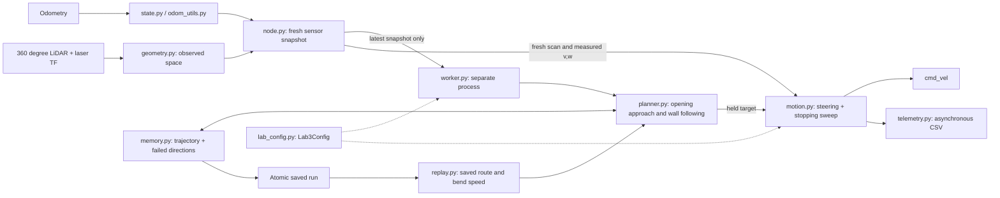

# Lab 3: learn the course, then improve the run

[Repository overview](../../../../../README.md#lab-3-maze-escape) ·
[Workspace quick start](../../../../README.md#lab-3-learn-and-replay)

Go-to-goal uses LiDAR and odometry to navigate an obstacle course and record
the driven route. The default goal is (10, 0) metres in the starting odometry
frame. The run completes when the robot reaches the configured goal tolerance.
Replay uses a completed route and checks shortcuts against current LiDAR.

## Connections and ownership



| File | Responsibility and main operations |
| --- | --- |
| `node.py` | ROS subscriptions, timestamp and TF checks, one velocity publisher, bounded worker queues, stop/save/reset services. Transforms a held map target into the continuous odometry frame. |
| `state.py` | `StateTracker.update()` keeps signed measured motion in the initial frame; `pose_at()` interpolates laser-time pose. `PoseEstimator` predicts a planar pose/covariance from odometry and applies gated Kalman corrections from accepted scan matches. |
| `geometry.py` | `process_scan()` preserves hits, valid no-return beams, and unknowns; `observed_travel()` checks robot-width travel; frame transforms and swept-circle tests. |
| `mapping.py` | For map-backed replay, `integrate()` accumulates bounded free/occupied evidence once per scan; `closed_ahead()` checks for an observed capped pocket; `align()` accepts only sufficiently strong, unambiguous local scan matches. |
| `planner.py` | Scores forward headings, checks opening approaches and wall-following arcs, and tracks replay waypoints. |
| `motion.py` | Ramps linear and angular commands from measured velocities and checks candidate arcs through a full stop. |
| `memory.py` | Samples the trajectory, penalizes failed directions, chooses a verified return point, and atomically saves/loads an NPZ without pickle. |
| `replay.py` | Trims loops and detours by estimated travel/turn time; checks full-footprint observed space, repairs tight corners locally, rounds corners when validated, and anticipates bend speeds. |
| `worker.py` | Runs planning and persistence in a separate process. Simulation uses the same `NavigationEngine`. |
| `telemetry.py` | Bounded background CSV writer recording measured/commanded speeds, modes, slowdown reasons, plan age, and callback timing. |
| `simulate.py` | Independent finite-response robot plant, ray-cast LiDAR, four regression courses, optional two-run comparison. |
| `plot.py` | Plots recorded CSV trajectory and measured versus commanded velocities. |
| `types.py` | Explicit scan/state/target/plan data passed between components. |

## Reusable helpers

The scan and geometry functions in [`geometry.py`](geometry.py) work without ROS.
Distances are in metres, angles are in radians, and scan geometry uses the robot
base frame at acquisition: x forward, y left. Their docstrings describe array
shapes, coordinate frames, and the meaning of each result.

| Helper | Use it for |
| --- | --- |
| `process_scan()` | Validate scan geometry, distinguish obstacle hits from no-return/unknown beams, and sort all beam arrays together in the base frame. |
| `scan_at_pose()` | Re-express a recorded scan at the current robot pose while preserving its acquisition time. |
| `transform_points()`, `inverse_points()`, `compose()`, `between()` | Convert points and poses between explicitly related frames. |
| `free_distances()` | Find travel before a circular robot would contact a sampled obstacle; this alone does not establish observed free space. |
| `observed()` | Check whether individual points fall inside known scan coverage. |
| `circles_observed()`, `circles_clear()` | Check complete footprints against obstacle hits and every angular interval, including missing beams. |
| `observed_travel()` | Combine contact distance with observed footprint coverage and a sampling reserve. |
| `grid_line()` | Visit grid cells along a line, including both endpoints. |
| `motion.approach()`, `motion.rollout()` | Apply signed acceleration/braking limits and predict the motion through latency, the command horizon, and a full stop. |

`process_scan()` returns finite range values for convenient geometry calculations.
Always use its `known` and `hits` masks: an unknown beam's stored length is a
placeholder, not free-space evidence. The robot adapter calls it with named
arguments so the acquisition pose, laser mounting transform, and two timestamps
are easy to distinguish.

## Decision behavior

1. Score observed forward segments using goal progress, clearance, steering
   effort, and recent failed directions. Hold the selected odometry waypoint
   through brief interruptions.
2. Check for opposing LiDAR returns ahead. Aim between them when the midpoint
   offers a clear approach and the controller can execute its initial arc.
   If the current line loses clearance, check small forward heading corrections.
3. On sustained blockage or a stall, pick a side and follow the obstacle forward.
   Keep that side while checking for an opening. A blocked forward sweep requests
   zero velocity while the planner reassesses current scans.
4. Ramp steering and translation together for recovery turns up to 45 degrees.
   Try the highest permitted command first and check slower commands when
   necessary. Every command must leave room for the full stopping sweep.
5. Exit wall following when two scans show a clear route to the goal after
   progress around the obstacle. Reach the goal tolerance to complete the run.

### Forward progress and recovery

When a nearby obstacle leaves a clear corridor, the planner holds an aligned
forward target while measured odometry shows progress. Recovery can select a
25 cm forward target after checking at least 30 cm of observed travel. Current
LiDAR and the complete stopping sweep are checked at each control cycle.

Forward commands take priority during local target selection. A turn-only
candidate requires a verified forward continuation at the aligned pose.
Changing a waypoint preserves the measured-progress reference. Sustained
blockage and stalls are recorded as failed directions before selecting another
target. Diagnostic selection values include `FORWARD_EXIT`, `HOLD_FORWARD`,
`OPEN_SPACE`, and `ALIGN_FOR_FORWARD`.

Route-only replay uses live steering and braking checks to set speed. Map-backed
replay also applies its route bend-speed profile. Replay advances its route index
monotonically and uses measured progress and blocked feedback for stall detection.

## Build and run on the ROS machine

From the repository's `amr_ws` directory:

```bash
source /opt/ros/humble/setup.bash
rosdep install --from-paths src --ignore-src -r -y
colcon build --symlink-install --packages-select py_amr_ttb
source install/setup.bash
ros2 launch py_amr_ttb lab3_go_to_goal.launch.py robot_namespace:=/TTB10
```

The launch starts driving once valid sensors and a plan arrive. Use one active
velocity controller. Topics are `/TTB10/odom`, `/TTB10/scan`, `/TTB10/cmd_vel`.
The odometry twist's child frame must match `base_frame`; laser TF must describe
a horizontal scan plane. An inverted laser is supported. Set `base_frame` in
the launch if the robot uses a prefixed frame name.

After a completed first run, stop the process, return the robot near its original
position and heading, then:

```bash
ros2 launch py_amr_ttb lab3_replay.launch.py robot_namespace:=/TTB10
```

Both launches accept `run_file:=/absolute/path/course.npz`. The default is
`~/amr_lab3_runs/course.npz`. Go-to-goal chooses and holds odometry waypoints using current LiDAR clearance.
It records the driven route and remembers failed directions for recovery.
For replay of a new recording, start from the same position and heading in the
same odometry coordinates. Replay checks each shortcut against current LiDAR.
Map-backed recordings use initial LiDAR alignment and can report
`ALIGNMENT_REQUIRED` if the starting pose is ambiguous.
Replay saves its result as `course.replay.npz`. Incomplete learning runs save to
`course.incomplete.npz`. A completed learning run is saved at `course.npz`.

Services:

```bash
ros2 service call /lab3_controller/stop std_srvs/srv/Trigger '{}'
ros2 service call /lab3_controller/save std_srvs/srv/Trigger '{}'
ros2 service call /lab3_controller/reset std_srvs/srv/Trigger '{}'
```

Stop queues a save and latches stopped. Reset requires stop and stationary
odometry; it begins a new run with a newly captured starting frame. Save is
asynchronous. A worker error or expired plan causes zero velocity. Normal
shutdown also commands zero and asks the worker to persist its latest state.

## Tuning

`Lab3Config` contains defaults; all fields are ROS startup parameters. For example:

```bash
ros2 run py_amr_ttb lab3_controller --ros-args \
  -p run_mode:=learn -p robot_namespace:=/TTB10 \
  -p goal_x:=10.0 -p max_linear:=0.30 \
  -p weight_goal:=0.40 -p weight_travel:=0.30 -p decision_period:=0.50
```

Restart to apply parameter changes. Defaults are experimental, not measured
calibration. Zero score weights are permitted.

| Purpose | Parameters / defaults |
| --- | --- |
| Speed and turn limits | `max_linear=0.30`, `max_angular=1.4`, `reverse_speed=0.08` |
| Physical response | `linear_acceleration=0.4`, `linear_braking=0.5`, `angular_acceleration=1.8`, `angular_braking=2.2`, `command_latency=0.10` |
| Footprint | `robot_radius=0.18`, `safety_margin=0.01`, extra `route_margin=0.10` for map-backed replay shortcuts |
| Timing | control 0.05 s, worker submission 0.20 s, blockage threshold at least `decision_period=0.50` s. Sensors expire at 0.40 s and plans at 1.50 s. |
| Lookahead | `scoring_horizon=1.5`, `target_distance=1.0`, `target_min_distance=0.15`, `target_reached=0.18` |
| Score weights | goal .40, travel .30, clearance .10, heading .10, rotation .10, history .35 |
| Slower candidate | `minimum_translation_speed=0.01` m/s is a provisional floor for the fallback candidate. Measure the base's useful speed before tuning it. |
| Recovery | `stall_timeout=3.0`, `progress_distance=0.15`, `backtrack_distance=0.70`, `attempt_radius=0.45` |
| Map | 0.05 m cells over 24 x 24 m; origin (-6,-12); bounded log-odds evidence |
| Pose uncertainty | `odom_translation_noise=0.03`, `odom_rotation_noise=0.04`, `alignment_position_noise=0.04`, `alignment_heading_noise=0.04`; innovation gate `11.34` |

The command limits follow the official
[TurtleBot 4 specifications](https://turtlebot.github.io/turtlebot4-user-manual/overview/features.html):
0.31 m/s with safety enabled and 1.9 rad/s. The default cruise setting is 0.30 m/s;
acceleration and braking settings are estimates that require measurement.

## Verification and limits

### Live timing and incomplete scan coverage

Live coverage preparation runs in one background thread using NumPy.
There is at most one preparation job. Incoming scans continue to update while it
runs, and the next job takes the newest observations. Each scan gets prepared
angular validity counts and minimum-range tables. Expiry selects eligible tables.
Live preparation can bridge invalid runs when valid beams bracket a gap of at
most 4 degrees. Inferred clearance ends at the shorter bracketing range or
0.50 m from the lidar, whichever is closer, with a chord bound across the gap.
This is a near-field inference. Raw validity and obstacle hits remain available
for mapping and collision checks. Wider gaps still require supporting scans.
The control callback uses fast circle-coverage queries and batched conservative
subdivision only where several scans must jointly cover a footprint.
It also checks current obstacle hits against each
stopping footprint. Planning receives the same prepared representation, expressed
in starting odometry coordinates. No eligible result produces WAITING_FOR_COVERAGE.
Run reset invalidates results submitted before the reset.

NumPy is the only numerical dependency for this coverage path. Offline callers
without prepared coverage retain the original geometry path.

Sensor freshness uses local monotonic receipt time. Robot timestamps still align
odometry, scans, and TF. A constant robot-to-PC clock offset requires no SSH or
NTP calibration. Receipt time cannot detect transport delay before arrival.

The node retains up to six scans within the existing 0.40-second sensor timeout.
Planning and motion combine pose-aligned coverage from these scans and retain
recent obstacle hits. Unresolved coverage cells fail closed. A 1 mm tolerance at
the already-occupied boundary accommodates tiny pose drift, while obstacle
contact retains the configured clearance radius.

Heading search rotates through forward sections across worker updates. The
worker yields between sections when the search reaches its time budget.
`SEARCHING_ROUTE` means the search is still in progress.

`NAV_TARGET` logs waypoint changes. Opening diagnostics record the estimated
width, heading, and accepted linear and angular command. Motion diagnostics
record heading error, target distance, clearance checks, and translation
rejections. `TURN_WITHOUT_PROGRESS` requests zero after one revolution of
accumulated turning without 0.05 m of odometry displacement.

Plans expire from their input snapshot time. completed_at and
input_age_at_completion record computation delay separately. Before publishing,
the node checks elapsed control time and the earliest expiry of the plan, raw
sensors, and eligible coverage sources used for the command. An overrun sends
zero with CONTROL_DEADLINE. Expired evidence sends zero with COMMAND_EXPIRED.
This check cannot preempt a running Python callback
or retract the previous command during that callback; hard real-time execution
has not been established.

Exact motion-failure JSON captures include scan history, the rejected result, and
its state/scan/plan/time/dt, controller state, and attempted translation commands.
The telemetry writer saves them beside the matching
CSV. NAV_DIAGNOSTIC includes coverage,
obstacle, history, timing, and planner-search details. Captured-frame replay and
unit tests do not establish sustained progress under live ROS scheduling.

Offline checks from the repository root (Python 3.10+ and NumPy):

```bash
python3 -m unittest discover -s amr_ws/src/py_amr_ttb/test -p test_lab3.py -v
PYTHONPATH=amr_ws/src/py_amr_ttb python3 -m py_amr_ttb.lab3.simulate \
  --scenario pocket --two-runs --output output/lab3-pocket
```

The simulator offers `straight`, `obstacle`, `corner`, `pocket`,
`corridor`, and `staggered`. The corridor is 42 cm wide. The staggered course
contains alternating wall ends with 57 cm openings. It reports elapsed
simulated time, actual wall clearance, peak speed, modes, and host worker timing.
Its plant has finite acceleration/braking different from the controller model.
It does not emulate ROS delivery, wheel slip, sensor noise, or physical contacts.

Hardware CSV logs are written under `log_dir`. Plot with:

```bash
ros2 run py_amr_ttb lab3_plot ~/amr_lab3_runs/learn-TIMESTAMP.csv
```

Map-backed replay uses local scan matching and a planar pose filter. Route-only
recordings use starting odometry coordinates. Scans use a single acquisition pose.
The simulator measures course completion and clearance under its own plant model.
