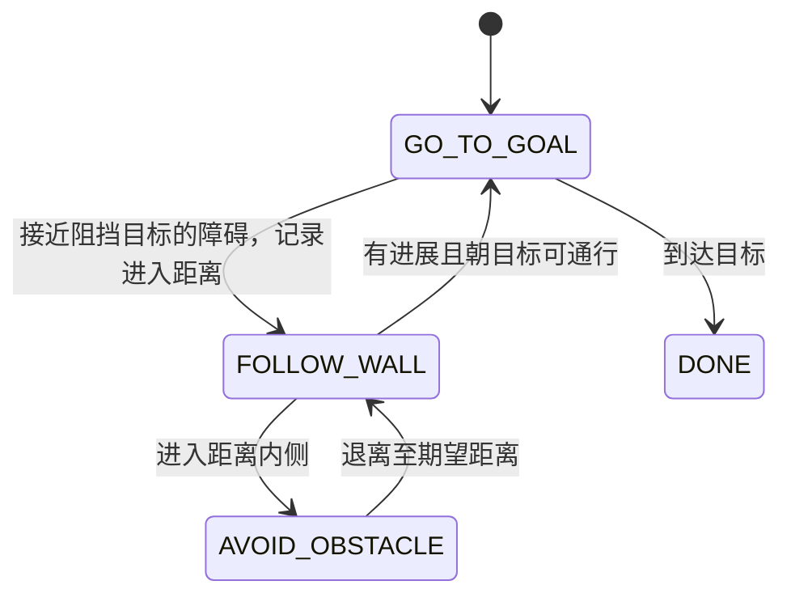

# Lab 3 与课程算法的对应

当前默认使用 **Lecture 6 势场连续引导 + 固定切向绕行 + Lecture 5 沿墙脱困**。`planner:=lecture` 保留纯课堂状态机作为对照；`planner:=potential` 为新版默认。底层方向和距离控制仍采用 Lecture 3 的比例控制结构。

这是有明确讲义依据的工程实现。课堂给出的平面向量场和切换条件，加上实际差速机器人所需的转向、距离调节、滞环和碰撞保护，构成当前程序。讲义没有要求 Lab 3 必须采用唯一指定算法；选择这套方法是因为它直接覆盖“用实时 LiDAR 绕过纸箱，再到达目标”的任务。

## 1. 所有讲义中相关内容的位置

页码为各 PDF 内的页码。与本任务直接相关的第 3、5、6 讲，其 PDF 页码也与页面右下角一致。

| 文件 | 相关内容 | 对本任务的用途 |
| --- | --- | --- |
| `AMR_1_histroy_types_of_robots.pdf` | 机器人分类、感知/规划/执行 | 背景 |
| `AMR_1_intro_logistics.pdf` | 课程安排和软件 | 环境背景 |
| `AMR_2_Poses_and_Transformations.pdf` | 第 6–14、21–23 页：位姿、坐标变换、四元数、TF | 起始坐标系、雷达到基座的变换 |
| `AMR_2_board_notes.pdf` | 6 页手写坐标变换推导 | 支持上面的坐标变换 |
| `AMR_3_UGV_model_control.pdf` | 第 36 页：分行为控制；第 42 页：Go-to-goal；第 43–44 页：沿墙；第 45 页：Pursuit | 到点、沿墙和选做跟随的控制结构 |
| `AMR_4_Linear_systems.pdf` | 状态空间、线性化、比例控制与稳定性 | 底层控制背景 |
| `AMR_5_stability_planning.pdf` | 第 37–42 页：GTG/AO 与卡住问题；第 45–49 页：沿边界和混合状态机；第 50–52 页：点云避障向量；第 54–82 页：Grassfire、Dijkstra、A* | 沿墙脱困与旧版对照来自第 45–50 页 |
| `AMR_6_Motion_Planning.pdf` | 第 7–14 页：图搜索；第 15–21 页：配置空间；第 23–60 页：可视图、分解、Voronoi、PRM、RRT；第 63–72 页：人工势场及局部极小值 | 默认势场引导的依据，以及其他规划方法 |
| `AMR_7_Max_Likelihood_EM.pdf` | 极大似然、Gaussian、EM | 估计方法，未作为当前绕箱控制器 |
| `AMR_8_Kalman_Filter_notes.pdf` | 手写 Kalman filter 推导 | 状态估计背景 |
| `AMR_8_KalmanFilter_Mapping.pdf` | Kalman/EKF、估计与地图 | 状态估计与建图背景 |
| `AMR_9_Particle_Filter_notes.pdf` | 手写粒子滤波、更新与重采样 | 定位背景 |
| `AMR_9_particle_filter.pdf` | 粒子滤波、里程计模型、地图表示与匹配 | 定位和地图背景 |

对比来看，图搜索、PRM 和 RRT 还需要构造相应的地图/碰撞模型。Lecture 5 的方法可直接使用当前扫描中的最近障碍点，适合本题已有的输入条件。

## 2. 新版默认势场与切向引导

Lecture 6 第 67–68 页给出吸引和排斥。实际代码在基座坐标系内使用目标向量 g、最近障碍外法向 n，令 rho = 最近点距离 - (robot_radius + safety_margin)。

```text
F_att = min(1, |g|) * g/|g|
F_rep = min(2.5, eta*(1/rho - 1/rho0)/rho^2) * n,  当 rho < rho0
F_rep = 0,                                              当 rho >= rho0
F = F_att + F_rep + w_t * R(+/-90deg)*n
```

默认 `eta=0.002`、`rho0=0.50 m`，排斥距离从膨胀后的车体边界计量。近处的可达目标前，排斥幅值按 `min(1, goal_distance/0.35)^2` 渐弱，以避免目标在障碍附近时不能收敛。吸引幅值封顶、排斥封顶与近目标渐弱是工程处理。

目标通道被挡且进入作用范围时，用 Lecture 5 第 47 页的点积方法选绕行侧，并保持该侧。切向权重目标为 `tangent_gain * max(0, 1-rho/rho0)`，默认 gain=4.0；以 0.15 s 时间尺度平滑。到目标的完整通道连续畅通且已取得进展后，取消绕行锁定并平滑撤去切向分量。这里采用通道判定；下面旧版沿墙控制器仍保留课堂的法向点积退出条件。

切向场不是势函数的负梯度，因此这是一种改进的向量场控制器，不能把整个 F 都称作原始 APF 梯度。

### 连续转向与速度

`omega = clip(Ktheta*atan2(F_y,F_x), +/- max_angular)`。新版允许中等转向误差时前进，`v = min(vmax, Kv*goal_distance)*max(0, cos(heading_error))`，不沿用旧版 0.55 rad 的突然停走门限。

随后以 `v*sensor_timeout + v^2/(2*braking_deceleration)` 约束可用的前方通道长度，限制加速度，并调用与旧版完全相同的弧线碰撞停车检查。两版速度上限、车体半径与硬安全余量一致。

### 沿墙脱困

目标被挡时，1.5 s 内位移不足 5 cm、6 s 内没有改善目标距离，或合成场幅值过低，会把当前速度、目标与已选方向交给 Lecture 5 控制器。脱困后达到课堂的退出条件才返回势场。固定目标始终为起始坐标系中的 (1.5,0)。

以下第 3–7 节说明旧版对照和脱困控制器的课堂依据。

## 3. Go-to-goal：Lecture 3 第 42 页

机器人启动时捕获固定起点，目标在这个起始坐标系中为

\[
p_g=(1.5,0)^T.
\]

对当前位置 \(p=(x,y)^T\)，目标距离和方向误差为

\[
d_g=\|p_g-p\|,\qquad
e_\theta=\operatorname{wrap}\bigl(\operatorname{atan2}(y_g-y,x_g-x)-\theta\bigr).
\]

讲义的结构是速度随目标距离变化、转向随角度误差变化。实现中对应

\[
v_0=\min(v_{\max},K_vd_g),\qquad
\omega=\operatorname{clip}(K_\theta e_\theta,-\omega_{\max},\omega_{\max}).
\]

并增加“大角度先转向、小角度再前进”的门限、加速度限制及最终碰撞检查。默认 \(d_g\le0.06\,\mathrm m\) 时持续停车。

## 4. 最近障碍向量：Lecture 5 第 50 页

第 50 页给出从点云选最近点的方法。第 51–52 页给出距离加权及检查运动方向等其他处理方式。本实现采用最近点方法，避免把不同方法混称为同一算法。

把扫描命中点转换到机器人基座坐标系，最近点记为 \(o_B\)，则

\[
d_o=\|o_B\|,\qquad n=-\frac{o_B}{\|o_B\|}.
\]

\(n\) 是从障碍指向机器人的单位法向量，也就是归一化后的避障方向。所有向量计算和点积都在同一个基座坐标系中进行。

## 5. 沿边界方向：Lecture 5 第 45、47 页

将向外法向量旋转 90 度，得到沿障碍走的两个切向量：

\[
t_{CW}=R(-\pi/2)n=\begin{bmatrix}n_y\\-n_x\end{bmatrix},\qquad
t_{CCW}=R(+\pi/2)n=-t_{CW}.
\]

第 47 页通过与目标向量的点积选择顺/逆时针方向。代码默认选择与当前目标向量 \(g_B\) 点积更大的切向量；两者相等时选顺时针。障碍在正前方时，顺时针绕障对应从箱子的左边通过。`preferred_side:=left/right` 是允许手动覆盖自动选择的实验参数。

第 45 页同时要求沿墙时保持距离。只取理想切向量，在有限采样、差速转向和纸箱拐角处会有距离误差，因此实现中加入径向误差反馈：

\[
u_{FW}=t+\operatorname{clip}\bigl(K_d(\Delta-d_o),-0.7,0.7\bigr)n.
\]

默认 \(\Delta=0.40\,\mathrm m\)，是**机器人中心到最近障碍点**的期望距离。距离太近时向外修正，太远时向内修正。这个具体反馈项和限幅属于工程实现，不是讲义逐字给出的公式。

## 6. 行为切换：Lecture 5 第 48–49 页



其中 `FOLLOW_WALL` 包含固定的 `FOLLOW_WALL_CW` 和 `FOLLOW_WALL_CCW` 两个方向。机器人太近且无法安全移动时，停车保护优先于这个行为图。

在每次进入沿墙时（包括从 AO 返回），保存

\[
d_\tau=\|p(\tau)-p_g\|.
\]

Lecture 5 第 48 页的退出沿墙条件是同时满足

\[
\underbrace{\|p-p_g\|<d_\tau}_{\text{已经更接近目标}},\qquad
\underbrace{\langle u_{AO},u_{GTG}\rangle>0}_{\text{目标方向与远离障碍方向同侧}}.
\]

本实现使用同方向的归一化 \(n\) 替代 \(u_{AO}\) 计算符号，并增加三项实际处理：

1. 距离至少改善 0.03 m，抑制里程计小幅波动。
2. 检查到目标的**完整车体通道**，防止最近点已在后方、但前方还有另一个障碍。
3. 条件连续满足 3 个控制周期才退出，减少反复切换。

Lecture 5 第 49 页的精确边界判断 \(d_o=\Delta\) 以滞环代替：接近 \(\Delta+0.025\) m 时可以进入沿墙；小于 \(\Delta-0.025\) m 时进入 `AVOID_OBSTACLE`；恢复到 \(\Delta\) 后返回原沿墙方向，并刷新进入距离 \(d_\tau\)。保留原方向用于减少抖动。

## 7. 从平面向量变成 TurtleBot 指令

讲义的 \(u_{GTG}\)、\(u_{AO}\)、\(u_{FW}\) 是平面运动方向。TurtleBot 不能横向平移，因此对当前行为的方向 \(u_B\) 计算

\[
e_\theta=\operatorname{atan2}(u_{B,y},u_{B,x}),\qquad
\omega=\operatorname{clip}(K_\theta e_\theta,-\omega_{\max},\omega_{\max}).
\]

角度误差大于约 0.55 rad 时先原地转向；允许前进时按 \(\cos^2(e_\theta)\) 降低弯道速度。距离过近的 `AVOID_OBSTACLE` 使用更低速度，面向避障方向后再向前驶离，程序不直接命令倒车。

这是差速运动约束下对课堂向量场的实现；不会把“向左的平面向量”误当成机器人能够直接侧移。

## 8. 与 Lecture 6 人工势场法的关系

Lecture 6 第 63–71 页介绍了

\[
U=U_{att}+U_{rep},\qquad F=-\nabla U,
\]

第 67 页给出目标吸引势，第 68 页给出障碍排斥势，第 72 页明确展示局部极小值问题。

新版默认已采用吸引/排斥场，并增加切向与脱困处理。`planner:=lecture` 则只使用前述 Lecture 5 行为切换，保留为可复现的旧版对照。

## 9. 选做 Follow-me 的课程依据

Lecture 3 第 45 页的 Pursuit 使用移动目标、保持跟随距离，并给出距离 PI 与方向 P 控制。现有 Follow-me 使用距离 P 控制（相当于其中积分增益为零）、方向 P 控制，并有停止距离死区。点簇获取、跨帧关联和丢失停车是任务所需的感知部分；讲义的这一页本身没有给出人体识别器。

## 10. 与 Lab 2 circle 相同的 ROS 接入

这一层不改变势场和沿墙算法。节点直接收发完整话题 `/TTB10/odom`、`/TTB10/scan`、`/TTB10/cmd_vel`，订阅使用 circle 的 `qos_profile_sensor_data`。launch 使用同样的 `ExecuteProcess + python -m` 模式，仅传入普通 ROS 参数；节点名为 `/lab3_controller`，机器人前缀由 `robot_namespace`（默认 `/TTB10`）控制。

与 circle 一样，只按本机单调时钟检查接收间隔，任一路超过 0.4 秒没有新有效数据就停车。不比较电脑日期与机器人消息日期，也不再设置独立的时间戳策略。接收检查无法识别持续到达的旧包或回放，也无法测量消息到达前的延迟。

雷达安装坐标变换是 Lab 3 避障所需的额外输入。TF 映射封装在 launch 中，仍按扫描时刻查询，缺失时停车。雷达与 TF 发布者内部时间仍需相容。完整扫描、无效测距、位姿跳变、车体余量和弧线停车检查保留。

`SENSOR_STOP` 会显示具体原因；首次收到里程计和有效雷达时分别打印确认信息。

## 11. 验证与局限

新增测试分别检查：顺逆时针选择、AO 恢复、径向距离反馈，以及退出沿墙时的“进展、法向点积、完整通道、连续满足”条件。五种纸箱位置场景和含 5 mm 测距噪声的右绕场景均使用实际控制器运行。

对照结果、噪声种子和失败的双障碍挑战都保存在交付包的 `validation/`，详见 `comparison/REPORT.md`。这些是理想二维仿真和 ROS 接口替身测试；当前环境没有 ROS 2 运行时或实体机器人。没有声称完成真实 DDS/TF 验证、底盘调参或任意障碍环境中的全局收敛证明。

完整课程源文件仍在本次上传的 `Lectures_export.zip` 中；源文件名称和页码见上表。
