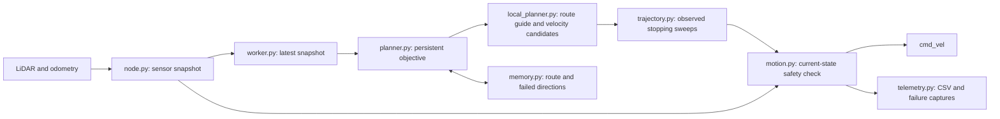

# Lab 3: navigate and replay a course

[Repository overview](../../../../../README.md) · [Workspace quick start](../../../../README.md)

Go-to-goal uses LiDAR and odometry to reach a configured goal and record the
route. The default goal is (10, 0) metres relative to the starting odometry
frame. Replay follows a completed recording from the same starting pose.

## Decision loop



1. **Keep one objective.** Use the goal, a saved replay waypoint, or a temporary
   detour. Small score changes do not replace the objective. After five seconds
   without a 5 cm reduction in objective distance, record the failed direction
   and try an observed detour. Reaching the detour returns to the goal.
2. **Find a local route around visible obstacles.** Build a disposable lattice
   from the latest scan, search around the inflated obstacle returns, and select
   a nearby visible route point. The lattice covers 4.8 m square at 5 cm spacing.
   It is discarded each update; learning builds no persistent occupancy map.
   Unknown space can suggest a route to investigate, but cannot authorize motion.
3. **Choose an executable motion.** Sample forward, stationary, and limited
   reverse velocities with several steering rates. Rank predicted progress,
   alignment, forward speed, and continuity of steering. Alignment uses the same
   current-to-guide bearing for every candidate, including those that pass the
   guide point. Diagnostics include `guide_distance` and `guide_heading` (radians).
   The prediction begins
   with measured velocity, includes acceleration and command latency, and ends
   after braking to rest. Only trajectories with observed, clear swept footprints
   are eligible. Check nominal steering and a second, slower response.
4. **Execute through an independent supervisor.** Every control tick, ramp toward
   the chosen command and recheck its stopping sweep using current sensing and
   measured motion. A failed check requests zero; the supervisor never chooses
   a competing route. Turning and forward motion can occur together.

Cumulative measured reverse travel is limited to `backtrack_distance` (0.70 m).
At least `progress_distance` (0.15 m) of forward travel resets that budget.
The run ends at the goal tolerance or `max_runtime`; no local method guarantees
escape from every maze or visibility configuration.

## Timing and geometry

| Item | Default |
| --- | --- |
| Control tick | 0.05 s |
| Worker submission interval (`map_period`) | 0.20 s |
| Sensor receipt timeout | 0.40 s |
| Command-plan lifetime | Smaller of `plan_timeout` and two worker intervals: 0.40 s |
| Candidate horizon / supervisor horizon | 0.70 s / 0.50 s, each followed by braking |
| Prediction sampling | 0.05 s, with enlarged midpoint footprints between samples |
| Local guide lookahead | 0.78 m |
| Forward / reverse speed caps | 0.46 / 0.08 m/s |
| Angular speed cap | 2.46 rad/s |
| Physical radius / clearance allowance | 0.18 / 0.01 m |
| Trajectory alignment / speed / steering-change weights | 0.08 / 0.08 / 0.015 |

`trajectory_alignment_weight`, `trajectory_speed_weight`, and
`trajectory_steering_weight` control candidate ranking. They multiply heading
improvement, signed forward speed, and absolute steering change respectively;
route progress has unit weight. These nonnegative weights do not relax the
stopping-sweep or observed-space checks.

Both Lab 3 launch files use these shared `Lab3Config` defaults for learning and
replay. No tuning arguments are needed for the standard launch commands.

These are scheduling targets and model assumptions, not measured hardware
performance. The circular collision radius is 0.19 m. A nominally wide enough
opening still needs a clear approach and stopping sweep.

Linear acceleration/braking defaults are 0.4/0.5 m/s²; angular defaults are
1.8/2.2 rad/s². `angular_response_fraction=0.75` checks another trajectory with
reduced angular acceleration and braking. Two sampled responses do not cover
every possible motor response; calibration remains necessary.

Sensor freshness uses **local monotonic receipt time**. Robot timestamps still
align scans, odometry and TF. A constant PC-to-robot clock offset needs no SSH
measurement or NTP synchronization. Receipt time cannot detect transport delay
that happened before delivery.

Coverage preparation uses one background job and up to six recent scans.
Pose-aligned free-space evidence expires with the sensor timeout. Current and
recent obstacle hits override free space. A small invalid-beam gap can be
inferred only when bracketed by valid beams: at most 4 degrees, limited by the
shorter bracketing range, its chord, and 0.50 m from the laser. Wider unknown
regions remain unverified. NumPy is the numerical dependency for navigation.

The worker has bounded latest-work queues. Plan age starts at the input snapshot,
not completion of the calculation. Before publishing, the node checks elapsed
control time and evidence expiry. A slow callback requests `CONTROL_DEADLINE`;
expired evidence requests `COMMAND_EXPIRED`. Python callbacks cannot preempt
already-running work or retract a previous command during that work.

## Modules

| File | Responsibility |
| --- | --- |
| `node.py` | ROS subscriptions, frames, sensor validation, background coverage, worker lifecycle, publishing and services |
| `state.py` | Starting odometry frame, signed measured velocity, acquisition-pose interpolation and replay pose filter |
| `geometry.py` | Scan validity, transforms, observed-space and footprint checks |
| `planner.py` | Goal/replay/detour ownership, progress tracking and reverse budget |
| `local_planner.py` | Bounded scan-local route search and velocity candidate ranking |
| `trajectory.py` | Acceleration/braking prediction and shared stopping-sweep validation |
| `motion.py` | Command ramping, expiry and independent current-state validation |
| `memory.py` | Route samples, local failed-direction penalties and atomic NPZ persistence |
| `mapping.py`, `replay.py` | Compatibility with map-backed recordings, alignment and verified route optimization |
| `worker.py` | Planning/persistence process; the same engine is used in simulation |
| `telemetry.py` | Bounded asynchronous CSV and failure JSON writing |
| `simulate.py`, `plot.py` | Repeatable closed-loop scenarios and optional plotting |

Route-only replay advances monotonically through the saved route and checks
shortcuts against current LiDAR. It uses the same live motion planner and safety
checks as learning. Replay is not guaranteed to be faster when the first run
already takes an efficient route. Map-backed recordings additionally require
initial alignment and retain their mapping support.

## Build and run

From the repository's `amr_ws` directory on the ROS machine:

```bash
source /opt/ros/humble/setup.bash
colcon build --symlink-install --packages-select py_amr_ttb
source install/setup.bash
ros2 launch py_amr_ttb lab3_go_to_goal.launch.py robot_namespace:=/TTB10
```

The launch drives once valid sensors and a plan arrive. Use one active velocity
controller. Topics are `/TTB10/odom`, `/TTB10/scan`, and `/TTB10/cmd_vel`. The
odometry twist's child frame must match `base_frame`, and laser TF must describe
a horizontal scan plane. An inverted laser is supported.

After a completed first run, stop the process and return the robot to its original
position and heading:

```bash
ros2 launch py_amr_ttb lab3_replay.launch.py robot_namespace:=/TTB10
```

Both launches accept `run_file:=/absolute/path/course.npz`. The default is
`~/amr_lab3_runs/course.npz`. Completed learning saves that file; incomplete runs
save `course.incomplete.npz`; replay saves `course.replay.npz`. A map-backed
recording can report `ALIGNMENT_REQUIRED` when its starting pose is ambiguous.

```bash
ros2 service call /lab3_controller/stop std_srvs/srv/Trigger '{}'
ros2 service call /lab3_controller/save std_srvs/srv/Trigger '{}'
ros2 service call /lab3_controller/reset std_srvs/srv/Trigger '{}'
```

Stop latches stopped and queues a save. Reset requires stop and stationary
odometry, then captures a new starting frame. Save is asynchronous. Shutdown
requests zero velocity and asks the worker to persist its latest state.

`Lab3Config` fields are ROS startup parameters. Restart to apply changes:

```bash
ros2 run py_amr_ttb lab3_controller --ros-args \
  -p robot_namespace:=/TTB10 -p goal_x:=10.0 -p max_linear:=0.46
```

## Diagnostics and tests

`NAV_TARGET` reports objective changes. `NAV_DIAGNOSTIC` records sensor and plan
ages, objective, candidate count, predicted path, route guide, worker duration,
reverse travel, and footprint rejection details. `NO_SAFE_TRAJECTORY` means no
candidate passed planning; `TRAJECTORY_BLOCKED` means the supervisor rejected
execution. Both have failure captures alongside the CSV, together with invalid
commands, sensor stops and control overruns. Captures retain the rejected cycle's
state, scan, plan, timing, configuration and result.

From the repository root, with Python 3.10+ and NumPy:

```bash
python3 -m unittest discover -s amr_ws/src/py_amr_ttb/test -p test_lab3.py -v
PYTHONPATH=amr_ws/src/py_amr_ttb python3 -m py_amr_ttb.lab3.simulate \
  --scenario diamond42 --seconds 45 --output output/lab3-diamond42
PYTHONPATH=amr_ws/src/py_amr_ttb python3 -m py_amr_ttb.lab3.simulate \
  --scenario pocket --two-runs --output output/lab3-pocket
```

Scenarios include `straight`, `obstacle`, `corner`, `pocket`, `corridor`,
`staggered`, `diamond40`, `diamond42`, and `extruded_wall42`. The photo approximations
are `photo_slalom` and `photo_switchback`. `example_course` approximates the
approved angular black-line checkpoint drawing (1033 by 1523 pixels), with an
assumed 4 mm/pixel scale, entering from the bottom and finishing near the top.
Connected wall boundaries and the separate upper island follow that outline.
The fixture is not a surveyed map; checkpoint guides are not obstacles.
For tuning comparisons, weight `example_course` at 65%, the two earlier photo
courses at 10% each, and the four generated mazes at 3.75% each. These are benchmark
weights, not controller inputs; a better average does not excuse a collision or
failure to finish. Compare elapsed time (50%), integrated absolute rotation (25%)
and total absolute linear-speed variation (25%), normalized to the same baseline
on each course. Validate finalists with shifted starts and slower motor response.
Four additional mixed-obstacle courses
are `maze_s_bend`, `maze_chicane`, `maze_offset_gate`, and `maze_double_bend`;
these combine diamond islands, wall protrusions and bending corridors. Passage tests hold
the entrance offset fixed while varying obstacle shape or width. Reports include
completion, ground-truth wall clearance, speeds, reasons, and host planning/control
timing. CSV and NPZ export do not require Matplotlib.

Tests check freshness, unknown-space rejection, braking and slower steering,
worker lifecycle, persistence, course completion and clearance. Diamond tests
also prohibit reverse motion and stationary turning. Replay completion tests
allow at most 10% timing overhead relative to learning; they do not assert a
universal speedup. The independent simulated plant has finite motor response,
but does not model ROS scheduling, sensor noise, wheel slip or contact physics.

Optional Matplotlib hardware-log plotting:

```bash
ros2 run py_amr_ttb lab3_plot ~/amr_lab3_runs/learn-TIMESTAMP.csv
```
