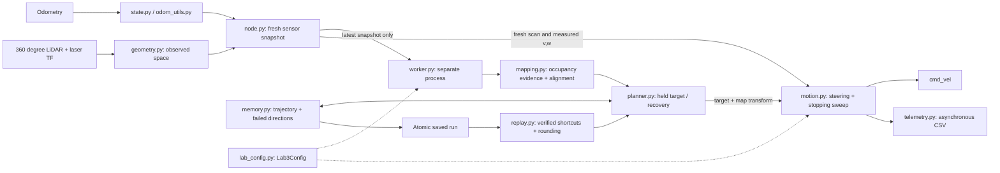

# Lab 3: learn the course, then improve the run

[Repository overview](../../../../../README.md#lab-3-maze-escape) ·
[Workspace quick start](../../../../README.md#lab-3-learn-and-replay)

This replaces the old potential-field, wander, follow-me, and coordinated Lab 3
controllers. It uses the existing `../odom_utils.py` for starting-frame pose math
and `Lab3Config` in `../lab_config.py` for every run's settings. Lab 1 and Lab 2
controllers are unchanged.

The assumed goal is `(10, 0)` metres in the first run's starting frame. There is
no camera or prepared map. Completion means reaching that coordinate within the
configured tolerance; **open space alone is not an exit detector**. Position and
orientation near the original start are needed for the second run.

## Connections and ownership



| File | Responsibility and main operations |
| --- | --- |
| `node.py` | ROS subscriptions, timestamp and TF checks, one velocity publisher, bounded worker queues, stop/save/reset services. Transforms a held map target into the continuous odometry frame. |
| `state.py` | `StateTracker.update()` keeps signed measured motion in the initial frame; `pose_at()` interpolates laser-time pose. `PoseEstimator` predicts a planar pose/covariance from odometry and applies gated Kalman corrections from accepted scan matches. |
| `geometry.py` | `process_scan()` preserves hits, valid no-return beams, and unknowns; `observed_travel()` checks robot-width travel; frame transforms and swept-circle tests. |
| `mapping.py` | `integrate()` accumulates bounded free/occupied evidence once per scan; `closed_ahead()` checks for an observed capped pocket; `align()` accepts only sufficiently strong, unambiguous local scan matches. |
| `planner.py` | Scores usable headings, holds reachable targets, commits to backtracking, and tracks replay waypoints. |
| `motion.py` | Uses measured velocities and validates one acceleration-limited translation per cycle; predicts latency and a complete stop. Separates heading alignment, angular braking, and translation rejection. |
| `memory.py` | Samples the trajectory, penalizes failed directions, chooses a verified return point, and atomically saves/loads an NPZ without pickle. |
| `replay.py` | Trims loops and detours by estimated travel/turn time; checks full-footprint observed space, repairs tight corners locally, rounds corners when validated, and anticipates bend speeds. |
| `worker.py` | Owns mapping/planning/persistence in a separate process. Provides the same `NavigationEngine` to simulation. |
| `telemetry.py` | Bounded background CSV writer recording measured/commanded speeds, modes, slowdown reasons, plan age, and callback timing. |
| `simulate.py` | Independent finite-response robot plant, ray-cast LiDAR, four regression courses, optional two-run comparison. |
| `plot.py` | Plots recorded CSV trajectory and measured versus commanded velocities. |
| `types.py` | Explicit scan/state/target/plan data passed between components. |

## Reusable helpers

The scan and geometry functions in [`geometry.py`](geometry.py) work without ROS.
Distances are in metres, angles are in radians, and scan geometry uses the robot
base frame at acquisition: x forward, y left. Their docstrings describe array
shapes, coordinate frames, and the meaning of each result.

| Helper | Use it for |
| --- | --- |
| `process_scan()` | Validate scan geometry, distinguish obstacle hits from no-return/unknown beams, and sort all beam arrays together in the base frame. |
| `scan_at_pose()` | Re-express a recorded scan at the current robot pose while preserving its acquisition time. |
| `transform_points()`, `inverse_points()`, `compose()`, `between()` | Convert points and poses between explicitly related frames. |
| `free_distances()` | Find travel before a circular robot would contact a sampled obstacle; this alone does not establish observed free space. |
| `observed()` | Check whether individual points fall inside known scan coverage. |
| `circles_observed()`, `circles_clear()` | Check complete footprints against obstacle hits and every angular interval, including missing beams. |
| `observed_travel()` | Combine contact distance with observed footprint coverage and a sampling reserve. |
| `grid_line()` | Visit grid cells along a line, including both endpoints. |
| `motion.approach()`, `motion.rollout()` | Apply signed acceleration/braking limits and predict the motion through latency, the command horizon, and a full stop. |

`process_scan()` returns finite range values for convenient geometry calculations.
Always use its `known` and `hits` masks: an unknown beam's stored length is a
placeholder, not free-space evidence. The robot adapter calls it with named
arguments so the acquisition pose, laser mounting transform, and two timestamps
are easy to distinguish.

## Decision behavior

1. Consider all 360 degrees: four front sections and four rear sections by default.
   Sample headings within each section and retain its best usable candidate.
   If a section has no usable coarse candidate, screen headings spaced at most
   0.5 degrees apart against obstacle hits. Check the best fine heading for full
   footprint coverage before it can become a target.
2. A candidate must have an observed, robot-width route to its target. Unknown
   continuation is eligible for exploration, but unknown cells are never declared
   safe just because a beam is missing.
3. Reward goal progress, observed travel, and clearance. Penalize heading change,
   change from measured angular velocity, and previously failed directions.
   A long path can win before its cap becomes visible.
4. An observed wall-to-wall gate and a bounded free-space search can establish a
   capped pocket. Encountering unknown cells or reaching the search budget means
   **unresolved**, not closed. This is a conservative local test, not a complete
   maze topology proof.
5. Hold the map-frame target through alignment and travel. Reconsider on arrival,
   sustained blockage, a verified capped route, or a stall. The controller checks
   every command against current sensing.
6. A stall, return to a recent location, or a confirmed cap triggers recovery.
   Backtracking stays committed until near its return point or blocked. Failed
   directions are penalized both at the failed position and the return point.
   Reversing is limited to this recovery behavior and uses the rear scan too.
7. New obstacles cause braking and a new decision. There is no fixed waiting
   delay before using another clear direction. If no usable route exists, stop
   and keep observing; the overall runtime limit prevents an endless run.

## Build and run on the ROS machine

From the repository's `amr_ws` directory:

```bash
source /opt/ros/humble/setup.bash
rosdep install --from-paths src --ignore-src -r -y
colcon build --symlink-install --packages-select py_amr_ttb
source install/setup.bash
ros2 launch py_amr_ttb lab3_go_to_goal.launch.py robot_namespace:=/TTB10
```

The launch starts driving once valid sensors and a plan arrive. Use one active
velocity controller. Topics are `/TTB10/odom`, `/TTB10/scan`, `/TTB10/cmd_vel`.
The odometry twist's child frame must match `base_frame`; laser TF must describe
a horizontal scan plane. An inverted laser is supported. Set `base_frame` in
the launch if the robot uses a prefixed frame name.

After a completed first run, stop the process, return the robot near its original
position and heading, then:

```bash
ros2 launch py_amr_ttb lab3_replay.launch.py robot_namespace:=/TTB10
```

Both launches accept `run_file:=/absolute/path/course.npz`. The default is
`~/amr_lab3_runs/course.npz`. Replay requires a completed run, compatible map
geometry/footprint/goal, and a convincing initial LiDAR alignment. The default
start search is +/-0.30 m and +/-0.10 rad. An ambiguous start remains stopped
with `ALIGNMENT_REQUIRED`; reposition the robot into recognizable geometry.
Replay saves its result as `course.replay.npz`. Incomplete learning runs save to
`course.incomplete.npz`. A completed learning run is saved at `course.npz`.

Services:

```bash
ros2 service call /lab3_controller/stop std_srvs/srv/Trigger '{}'
ros2 service call /lab3_controller/save std_srvs/srv/Trigger '{}'
ros2 service call /lab3_controller/reset std_srvs/srv/Trigger '{}'
```

Stop queues a save and latches stopped. Reset requires stop and stationary
odometry; it begins a new run with a newly captured starting frame. Save is
asynchronous. A worker error or expired plan causes zero velocity. Normal
shutdown also commands zero and asks the worker to persist its latest state.

## Tuning

`Lab3Config` contains defaults; all fields are ROS startup parameters. For example:

```bash
ros2 run py_amr_ttb lab3_controller --ros-args \
  -p run_mode:=learn -p robot_namespace:=/TTB10 \
  -p goal_x:=10.0 -p max_linear:=0.30 \
  -p weight_goal:=0.40 -p weight_travel:=0.30 -p decision_period:=0.50
```

Restart to apply parameter changes. Defaults are experimental, not measured
calibration. Zero score weights are permitted.

| Purpose | Parameters / defaults |
| --- | --- |
| Speed and turn limits | `max_linear=0.30`, `max_angular=1.4`, `reverse_speed=0.08` |
| Physical response | `linear_acceleration=0.4`, `linear_braking=0.5`, `angular_acceleration=1.8`, `angular_braking=2.2`, `command_latency=0.10` |
| Footprint | `robot_radius=0.18`, `safety_margin=0.04`, extra `route_margin=0.10` for replay shortcuts |
| Timing | control 0.05 s, map 0.20 s, blockage threshold at least `decision_period=0.50` s. Sensors expire at 0.40 s and plans at 1.50 s. |
| Lookahead | `scoring_horizon=1.5`, `target_distance=1.0`, `target_min_distance=0.15`, `target_reached=0.18` |
| Score weights | goal .40, travel .30, clearance .10, heading .10, rotation .10, history .35 |
| Slower candidate | `minimum_translation_speed=0.01` m/s is a provisional floor for the fallback candidate. Measure the base's useful speed before tuning it. |
| Recovery | `stall_timeout=3.0`, `progress_distance=0.15`, `backtrack_distance=0.70`, `attempt_radius=0.45` |
| Map | 0.05 m cells over 24 x 24 m; origin (-6,-12); bounded log-odds evidence |
| Pose uncertainty | `odom_translation_noise=0.03`, `odom_rotation_noise=0.04`, `alignment_position_noise=0.04`, `alignment_heading_noise=0.04`; innovation gate `11.34` |

The command limits follow the official
[TurtleBot 4 specifications](https://turtlebot.github.io/turtlebot4-user-manual/overview/features.html):
0.31 m/s with safety enabled and 1.9 rad/s. The default cruise setting is 0.30 m/s;
acceleration and braking settings are estimates that require measurement.

## Verification and limits

### Live timing and incomplete scan coverage

Live coverage preparation runs in one background thread using NumPy.
There is at most one preparation job. Incoming scans continue to update while it
runs, and the next job takes the newest observations. Each scan gets prepared
angular validity counts and minimum-range tables. Expiry selects eligible tables.
Live preparation can bridge invalid runs when valid beams bracket a gap of at
most 4 degrees. Inferred clearance ends at the shorter bracketing range or
0.50 m from the lidar, whichever is closer, with a chord bound across the gap.
This is a near-field inference. Raw validity and obstacle hits remain available
for mapping and collision checks. Wider gaps still require supporting scans.
The control callback uses fast circle-coverage queries and batched conservative
subdivision only where several scans must jointly cover a footprint.
It also checks current obstacle hits against each
stopping footprint. Planning receives the same prepared representation, expressed
in starting odometry coordinates. No eligible result produces WAITING_FOR_COVERAGE.
Run reset invalidates results submitted before the reset.

NumPy is the only numerical dependency for this coverage path. Offline callers
without prepared coverage retain the original geometry path.

Sensor freshness uses local monotonic receipt time. Robot timestamps still align
odometry, scans, and TF. A constant robot-to-PC clock offset requires no SSH or
NTP calibration. Receipt time cannot detect transport delay before arrival.

The node retains up to six scans within the existing 0.40-second sensor timeout.
Planning and motion combine pose-aligned coverage from these scans and retain
recent obstacle hits. Unresolved coverage cells fail closed. A 1 mm tolerance at
the already-occupied boundary accommodates tiny pose drift, while obstacle
contact retains the configured clearance radius.

Heading search rotates through angular sections across worker updates, yielding
after a section when the search has spent half the map period. This is a soft
budget: a section and mapping can exceed it. SEARCHING_ROUTE means another
section will be examined on a subsequent update. Selection can now accept the
best candidate from a partial search rather than ranking every section first.

Worker submissions respect map_period even after blockage. A single target
commitment interval holds a waypoint through transient stops. Alignment begins at
rotate_threshold and ends below alignment_tolerance (0.15 rad). When aligned,
After deliberate alignment, BRAKE_ROTATION requests zero until measured angular
speed falls below angular_settle_speed (0.15 rad/s). Normal tracking can steer
continuously. If the initial translation fails, the controller checks one slower
candidate. When both fail, it reports TRANSLATION_COVERAGE or TRANSLATION_OBSTACLE
and checks the predicted stop. The next cycle can drive when fresh coverage supports it.

The planner accumulates blocked samples for the attempted waypoint across brief
interruptions. It tracks progress in odometry and scales the required displacement
for slower reverse travel. A stalled backtrack is released, and RECOVERY_STALLED
reports that the subsequent search found no verified alternative. The planner
checks for known caps at both the current position and candidate waypoint. Replay
can rejoin its next saved waypoint with the normal footprint check when the extra
shortcut margin is unavailable. Live stopping-sweep checks still apply.

New waypoints must exceed target_reached by at least 0.05 m as well as satisfy
target_min_distance. When there is no regular or backtrack route, the planner
can select an APPROACH waypoint ahead with 0.10 m of verified usable travel.
The short waypoint reserves 0.02 m and uses a 0.025 m arrival tolerance so the
robot can take a small step and check the opening again. The footprint and
stopping-sweep checks apply throughout. NAV_TARGET logs target changes. CSV diagnostics include
heading error, target distance, and translation rejection.
Sensor and compute waiting are distinguished from route blockage.

Plans expire from their input snapshot time. completed_at and
input_age_at_completion record computation delay separately. Before publishing,
the node checks elapsed control time and the earliest expiry of the plan, raw
sensors, and eligible coverage sources used for the command. An overrun sends
zero with CONTROL_DEADLINE. Expired evidence sends zero with COMMAND_EXPIRED.
This check cannot preempt a running Python callback
or retract the previous command during that callback; hard real-time execution
has not been established.

Exact motion-failure JSON captures include scan history, the rejected result, and
its state/scan/plan/time/dt, controller state, and attempted translation commands.
The telemetry writer saves them beside the matching
CSV. Worker snapshots of the following cycle are no longer used for that purpose. NAV_DIAGNOSTIC includes coverage,
obstacle, history, timing, and planner-search details. Captured-frame replay and
unit tests do not establish sustained progress under live ROS scheduling.

Offline checks from the repository root (Python 3.10+ and NumPy):

```bash
python3 -m unittest discover -s amr_ws/src/py_amr_ttb/test -p test_lab3.py -v
PYTHONPATH=amr_ws/src/py_amr_ttb python3 -m py_amr_ttb.lab3.simulate \
  --scenario pocket --two-runs --output output/lab3-pocket
```

The implementation was checked locally with 28 passing Lab 3 tests. The existing
Lab 1/2 and shared-utility tests also passed; seven existing plotting checks were
skipped because Matplotlib was unavailable to that test environment. Python
compilation and the Git whitespace check passed. Formatting and ament lint have
not been verified in this environment.

The simulator also offers `straight`, `obstacle`, and `corner`. It reports elapsed
simulated time, actual wall clearance, peak speed, modes, and host worker timing.
Its plant has finite acceleration/braking different from the controller model.
It does not emulate ROS delivery, wheel slip, sensor noise, or physical contacts.

Hardware CSV logs are written under `log_dir`. Plot with:

```bash
ros2 run py_amr_ttb lab3_plot ~/amr_lab3_runs/learn-TIMESTAMP.csv
```

Local matching and a three-state Kalman update improve pose consistency when
geometry is distinctive. Odometry advances the pose and grows its covariance;
accepted scan matches reduce uncertainty after an innovation check. Increases
in reported odometry variance supplement configurable process noise. This is
**not full SLAM or a calibrated uncertainty bound**: the map and measurements
are correlated, and old poses are not globally adjusted. Occupancy evidence
is a practical confidence accumulator, not a calibrated probability guarantee.
Scans currently use one acquisition pose, not per-beam motion compensation.
These limitations and the physical acceleration/braking values must be evaluated
on the robot before treating near-limit speed as reliable. The runtime keeps
the robot's existing firmware safety behavior enabled.

ROS build/transport, full ament lint checks, real TF/QoS, LiDAR timing, and robot
trials are separate validation steps; passing offline tests does not establish
them. Tune measured braking and latency before increasing speed or shrinking
the footprint margin.
