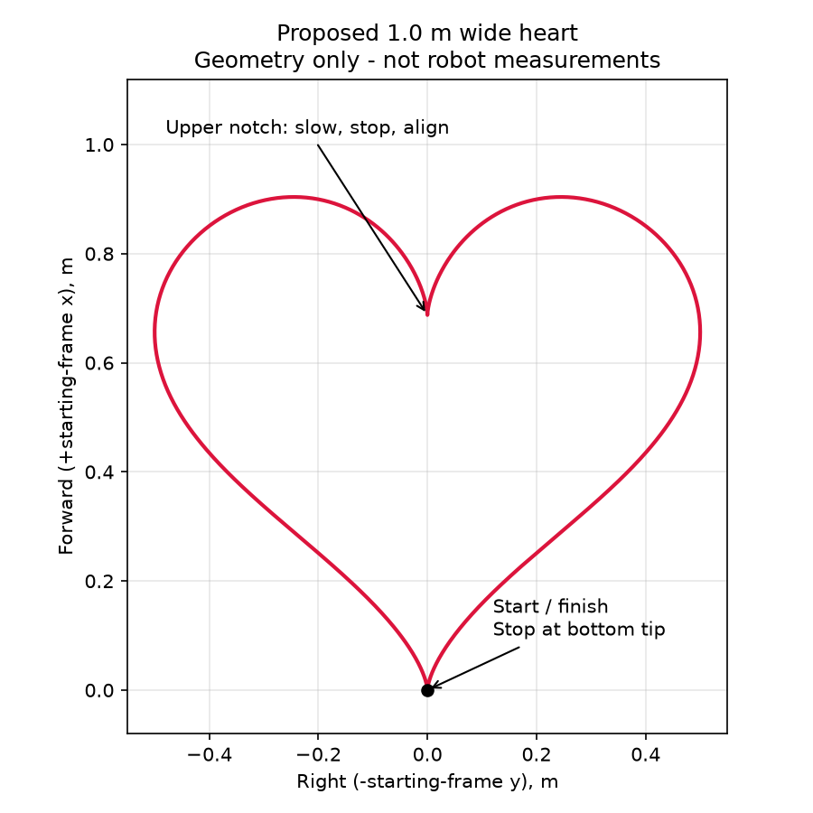

# Heart design and implementation

The smooth version is now implemented: geometry and `HeartPath` are in
`navigation.py`, with `lab2_heart.py`, a package-local launch, setup entry,
configuration, plotting and offline tests. The historical file split below
was simplified to keep pathing in navigation.py as requested. See the
[heart running guide](../amr_ws/src/py_amr_ttb/py_amr_ttb/lab2/HEART_README.md).
Physical heart validation remains pending; the design figure is geometry only.

Keep the demonstrated star as `lab2_star`. Add a separate `lab2_heart` task;
do not replace the star route or call the circle-specific path a heart.

## Geometry and starting convention

Generate a closed parametric curve, using t from pi to 3*pi:

```text
X(t) = 16 sin(t)^3
Y(t) = 13 cos(t) - 5 cos(2t) - 2 cos(3t) - cos(4t)
scale = desired_width_m / 32
x_forward(t) = scale * (Y(t) + 17)
y_left(t) = -scale * X(t)
```

The bottom tip is (0, 0), the symmetry axis points along initial +x, and the
curve first enters the left lobe. The total lateral width is the requested
width. The axes stay fixed, matching the existing odometry convention.



## Implementation options

1. First working version: select about 20 ordered points and reuse
   `waypoint_command`. This produces a recognizable polygonal heart, with a
   turn/stop at every point. Ensure adjacent points are farther apart than
   the arrival tolerance; dense sampling with the existing 0.05 m tolerance
   can skip short sections. This is the smallest implementation change.
2. Recommended smooth version: resample the curve by arc length, then use a
   polyline path follower with monotonic segment progress and a forward
   lookahead target. Reuse only `pursuit_command` for steering: `CirclePath`
   and `CircleProgress` assume a circular center/phase and cannot track a heart.

The heart has sharp points at the bottom and upper notch. Split tracking at
these points, approach slowly, explicitly stop, align to the next segment,
and resume. Do not let lookahead jump across the notch or closure. Completion
must require traversal of the full ordered route plus return within position
tolerance; being at the starting origin on the first callback is not completion.

Suggested first tuning values (unvalidated): width 1.0 m, speed 0.08 m/s,
lookahead 0.12 m for the smooth version. Reduce speed near high curvature;
retain angular limits, odometry validity/freshness stops, and shutdown stop.
Change these values only after ideal-model simulation and controlled robot trials.

## Final file layout

- `lab2/navigation.py`: `heart_points`, arc-length sampling and `HeartPath` progress.
- `lab2/lab2_heart.py`: explicit ROS wiring and heart control/completion logic.
- `lab_config.py`: HEART_WIDTH, HEART_SPEED, HEART_LOOKAHEAD and cusp settings.
- `launch/lab2_heart.launch.py` and its setup.py executable registration.
- `scripts/plot_lab2.py`: a heart overlay using the same geometry and run width.
- Tests for geometry closure/width, rotated starting frame, notch handling,
  no early completion, stale-data stops and ideal-model route completion.

No separate heart_path.py was added. Star/square waypoint logic remains in
navigation.py alongside the heart's continuous path tracker.

## Robot validation

Record while stationary before launch. Confirm the left/right lobes, notch,
return to the bottom tip, and persistent stop. Plot measured odometry against
the intended heart and save the width/controller settings with the recording.
The proposed image above is geometry only, not a demonstration result.
